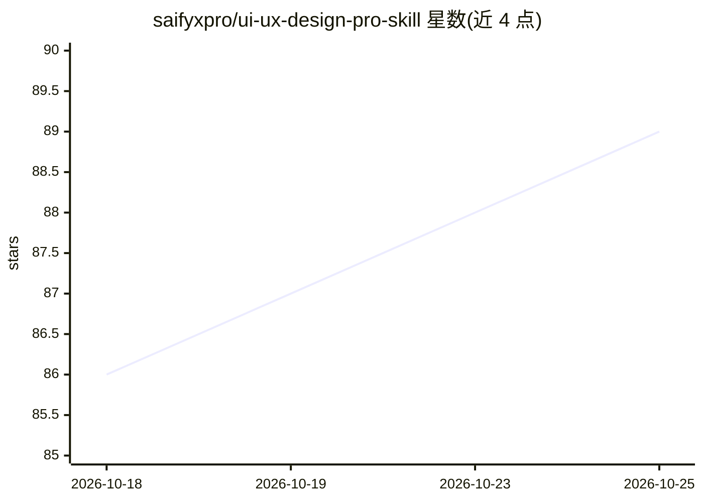

# saifyxpro/ui-ux-design-pro-skill

⭐ 91 · TypeScript · MIT · 推送 2026-09-15 · [GitHub](https://github.com/saifyxpro/ui-ux-design-pro-skill) · 个人维护

**给 AI 编程助手的 UI/UX 设计技能包：设计数据+CLI+规则库**

面向 AI 编程助手（Claude、Cursor 等）的 UI/UX 设计技能：提供 107+ UI 风格、127 配色、107 字体搭配、150+ 推理规则与 UX 指南共 1,875+ 数据行，通过 Bun 运行时与 Orama 搜索引擎构建的统一 TypeScript CLI 提供 search、generate、icons、audit 四类命令；generate 命令按项目需求生成 Markdown 设计系统（含 React/Tailwind 代码与 WCAG 无障碍说明），audit 命令用 12 条规则检测 UI 代码问题（含 AI 生成幻觉检测）。支持 16 种技术栈，需 Bun 1.0+ 运行时，经 npx skills 或 git clone 安装。

## 筛选速览

| 维度 | 判定 | 备注 |
|---|---|---|
| AI 角色 | `ai-ecosystem` | LLM/agent 周边工具 |
| 许可风险 | `permissive` | MIT |
| 部署形态 | `library` | 以包/库形式分发 |
| 模型依赖 | — | README 未给出锁定关系 |
| 硬件要求 | — | 无带数字的原话,不猜 |
| 安装摩擦 | `low` | 无编译、无系统依赖或容器化 |
| 成熟度 | — | 结构信号不足 |

## 能力要点

- 1,875+ 设计数据行：107+ 风格 / 127 配色 / 107 字体搭配 / 150+ 推理规则
- Bun + Orama 统一 CLI：search / generate / icons / audit 四类命令
- 设计系统生成器输出 Markdown，含 React/Tailwind 代码与 WCAG 说明
- audit 命令含 12 条规则，可检测 AI 生成的 Tailwind 幻觉 utility 与对比度问题

## 适用场景

- 在 Claude/Cursor 等编程助手中生成行业定制的设计系统
- 搜索风格、配色、字体搭配与图标 CDN 链接
- 审计 AI 生成的 UI 代码的可访问性与幻觉 utility

## 场景标签

`代码生成` `代码审查` · 领域:编码与开发

## 证据(README 行号)

> L13: A senior-level AI skill that provides data-driven design intelligence for building premium, production-grade UI/UX 
> L211: ├── skills/                     # AI Skill Definitions

## 星数曲线

2026-10-18 86 → 2026-10-25 89（+3）

---
*卡片 v1 · prompt 1.4 · 生成 2026-10-23 · 置信度 high · 依据 README sha `93923c4c58ff` · [字段定义](../../DATASET.md)*
