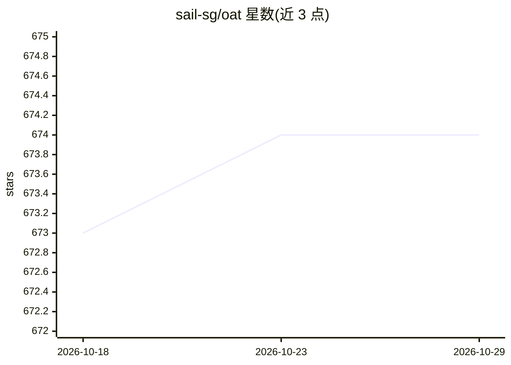

# sail-sg/oat

⭐ 674 · Python · Apache-2.0 · 推送 2026-01-29 · [GitHub](https://github.com/sail-sg/oat) · 组织维护

**面向研究的 LLM 在线对齐训练框架，支持 PPO/GRPO/在线 DPO 等算法**

OAT 是用于运行 LLM 在线对齐算法的研究框架，采用分布式 Actor-Learner-Oracle 架构：Actor 用 vLLM 加速在线采样，Learner 用 DeepSpeed ZeRO 提升显存效率，Oracle 以 Mosec 远程服务提供偏好标注与随时评估。实现 PPO/Dr.GRPO、在线 DPO/SimPO/IPO 及 SEA/APL/XPO 等在线探索算法，支持可验证奖励、轻量/远程奖励模型与 LLM-as-a-judge。面向科研人员快速原型化与基准实验，通过 pip 安装，最少可在两块 GPU 上测试。

## 筛选速览

| 维度 | 判定 | 备注 |
|---|---|---|
| AI 角色 | `ai-ecosystem` | LLM/agent 周边工具 |
| 许可风险 | `permissive` | Apache-2.0 |
| 部署形态 | `library` | 以包/库形式分发 |
| 模型依赖 | local-ok | 支持本地模型 |
| 硬件要求 | — | 无带数字的原话,不猜 |
| 安装摩擦 | `low` | 无编译、无系统依赖或容器化 |
| 成熟度 | — | 结构信号不足 |

## 能力要点

- 分布式 Actor-Learner-Oracle 架构（vLLM + DeepSpeed + Mosec）
- PPO/Dr.GRPO、在线 DPO/SimPO/IPO、SEA/APL/XPO 等在线算法
- 支持 RLVR、轻量/远程奖励模型与 LLM-as-a-judge
- 最少两块 GPU 即可快速测试

## 适用场景

- 研究者在数学推理任务上做在线 RL 训练（如 R1-Zero 式训练）
- 在线偏好学习与主动对齐算法的原型化实验
- 训练中实时查询偏好标注与评估曲线监控

## 场景标签

`强化学习` · 领域:训练与推理

## 证据(README 行号)

> L18: Oat 🌾 is a simple yet efficient framework for running **online** LLM alignment algorithms. Its key features include
> L20: * **High Efficiency**: Oat implements a distributed *Actor-Learner-Oracle* architecture, with each component being 
> L31: * **Cutting-Edge Algorithms**: Oat implements state-of-the-art online algorithms, fostering innovation and fair ben

## 星数曲线

2026-10-18 673 → 2026-10-29 674（+1）

---
*卡片 v1 · prompt 1.4 · 生成 2026-10-22 · 置信度 high · 依据 README sha `b50b020ef922` · [字段定义](../../DATASET.md)*
