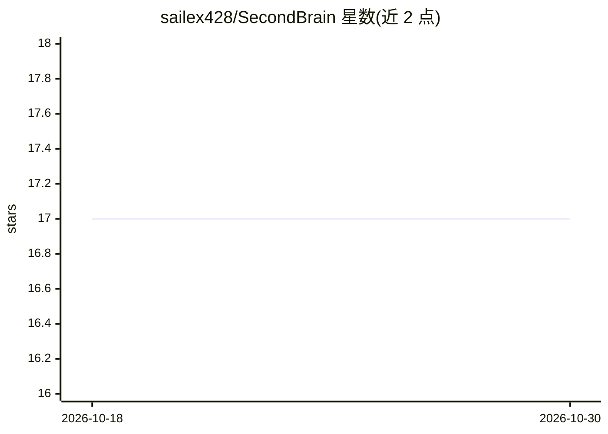

# sailex428/SecondBrain

⭐ 17 · Java · LGPL-3.0 · 推送 2026-07-23 · [GitHub](https://github.com/sailex428/SecondBrain) · 个人维护

**Minecraft Fabric 模组：创建由 LLM 驱动的可对话 NPC**

服务端运行的 Fabric 模组，在 Minecraft 1.20.1 世界中生成由大语言模型控制的类玩家 NPC：NPC 响应聊天消息、执行基础玩家动作，支持 TTS 朗读输出，可通过按住 alt/opt 键直接语音对话。后端可选本地 Ollama 服务器、OpenAI API key 或 Player2 App（免费受限）。通过 Modrinth 下载 jar 放入 mods 文件夹安装，需同时装在客户端用于设置；GUI 用于创建、编辑、删除 NPC。README 标注开发状态为修复任务执行问题并更新版本。

## 筛选速览

| 维度 | 判定 | 备注 |
|---|---|---|
| AI 角色 | `ai-native` | 本体是模型或模型工具 |
| 许可风险 | `viral` | LGPL-3.0 |
| 部署形态 | `None` |  |
| 模型依赖 | local-ok | 支持本地模型 |
| 硬件要求 | — | 无带数字的原话,不猜 |
| 安装摩擦 | `low` | 无编译、无系统依赖或容器化 |
| 成熟度 | `idea` | |

## 能力要点

- NPC 由 LLM 控制，响应聊天并执行基础玩家动作
- 支持 Ollama 本地服务器、OpenAI key、Player2 App 三种后端
- GUI 管理 NPC 与配置，聊天/语音交互，NPC 可开 TTS
- 完全服务端运行，客户端仅需安装用于设置

## 适用场景

- 在我的世界里放置能对话的 AI NPC
- 用本地 Ollama 免费运行 NPC 对话
- 单人或多人服务器中与 AI 角色互动

## 场景标签

`聊天机器人` · 领域:对话与助手

## 证据(README 行号)

> L4: A Fabric mod that brings intelligent NPCs to your minecraft world. Create player-like characters controlled by LLMs 
> L13: - **Running Ollama server OR Player2 App OR an OpenAi Key**

## 星数曲线

2026-10-18 17 → 2026-10-30 17（+0）

---
*卡片 v1 · prompt 1.4 · 生成 2026-10-29 · 置信度 high · 依据 README sha `7ec126928e5b` · [字段定义](../../DATASET.md)*
