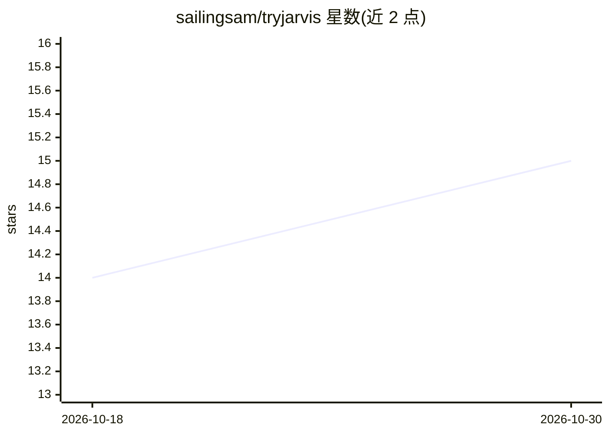

# sailingsam/tryjarvis

⭐ 15 · Python · NOASSERTION · 推送 2026-09-21 · [GitHub](https://github.com/sailingsam/tryjarvis) · [官网](https://tryjarvis.in) · 个人维护

**Linux 个人语音助理：记住你的事并代你行动**

以 pip 包安装的 Linux 个人参谋/助理，语音唤醒对话（默认全本地 Whisper+Piper+openWakeWord），支持按键说话与纯文本模式；维护 SQLite 持久记忆（人物、承诺、计划）及来源，可查看 memory/commitments/daily brief。通过 MCP 工具注册表接入 WhatsApp、Gmail、Spotify 等服务，后台 daemon 保持连接，可装 systemd 用户服务开机自启。STT/TTS 提供商可替换。自述 beta、仅 Linux、0.x 版本，尚未支持主动发起对话与定时提醒。

## 筛选速览

| 维度 | 判定 | 备注 |
|---|---|---|
| AI 角色 | `ai-native` | 本体是模型或模型工具 |
| 许可风险 | `none` | NOASSERTION |
| 部署形态 | `library` | 以包/库形式分发 |
| 模型依赖 | — | README 未给出锁定关系 |
| 硬件要求 | — | 无带数字的原话,不猜 |
| 安装摩擦 | `low` | 无编译、无系统依赖或容器化 |
| 成熟度 | `idea` | |

## 能力要点

- 默认语音栈全本地：Whisper 听、Piper 说、openWakeWord 唤醒，数据不出本机
- SQLite 持久记忆带来源（provenance），可命令行查看事实与未闭环承诺
- MCP 工具注册表接入 WhatsApp/Gmail/Calendar/Spotify/GitHub/Notion 等
- 后台 daemon + systemd 用户服务 + 托盘状态图标与麦克风硬静音

## 适用场景

- 用语音管理日常事务，让助理记住我提到的人和承诺
- 接通 WhatsApp 等消息渠道，离线会话期间持续捕获消息
- 查看每日简报和未闭环事项

## 场景标签

`语音 Agent` `AI 助手` `Agent 记忆` · 领域:Agent 开发

## 证据(README 行号)

> L5: Mantrin (you'll also see it called Jarvis — that's the name it answers to, and
> L51: The default stack is free and entirely local — Whisper for hearing, Piper for

## 星数曲线

2026-10-18 14 → 2026-10-30 15（+1）

---
*卡片 v1 · prompt 1.4 · 生成 2026-10-30 · 置信度 high · 依据 README sha `b8a240d20009` · [字段定义](../../DATASET.md)*
