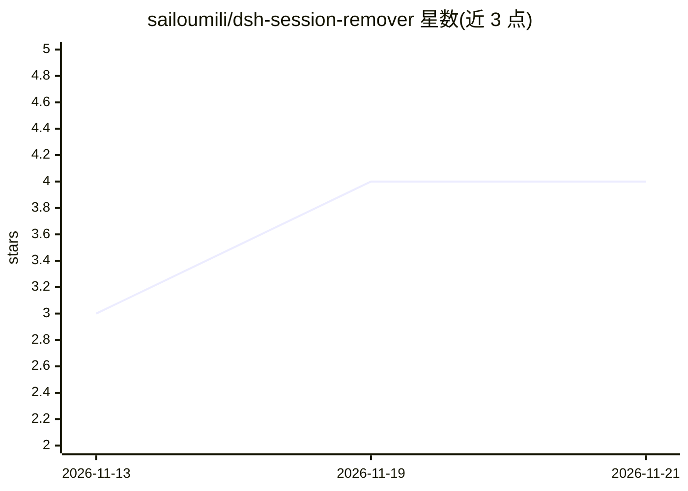

# sailoumili/dsh-session-remover

⭐ 4 · JavaScript · MIT · 推送 2026-10-25 · [GitHub](https://github.com/sailoumili/dsh-session-remover) · 个人维护 · 中文 README

**给 DSH 侧栏加删除/批量删除会话并移入回收站的插件**

面向 DSH（DeepSeek Harness）用户的会话管理插件：在侧栏会话行的「…」菜单中追加「删除对话」与「批量删除…」两项，将对话连同不显示在侧栏的子代理会话一并移入 Windows 回收站，并清理投影缓存、工作区记账、归档集合三处记录。删除采用同盘移动而非复制，删除前校验目标磁盘回收站可用性、核对目录编号唯一性，任一不满足即拒绝删除而不退化为永久删除；回收站中的文件可还原。兼容 DSH 0.1.7+ 的网页版与桌面版，仅支持 Windows，无第三方运行时依赖，MIT 许可。

## 筛选速览

| 维度 | 判定 | 备注 |
|---|---|---|
| AI 角色 | `ai-enhanced` | 去掉 AI 部分产品仍成立 |
| 许可风险 | `permissive` | MIT |
| 部署形态 | `desktop` | 安装包/桌面程序 |
| 模型依赖 | — | README 未给出锁定关系 |
| 硬件要求 | — | 无带数字的原话,不猜 |
| 安装摩擦 | `low` | 无编译、无系统依赖或容器化 |
| 成熟度 | — | 结构信号不足 |

## 能力要点

- 删除与批量删除的会话移入 Windows 回收站，可从回收站还原
- 一并清理不显示于侧栏的子代理会话；fork 出的分叉会话不连带删除
- 删除前多重安全校验：回收站可用性、编号唯一性核对，不满足即拒绝删除
- 端点仅接受本机回环地址请求，局域网来源返回 403

## 适用场景

- 在 DSH 中删除不再需要的对话及其子代理会话
- 批量勾选多个会话一次性删除
- 误删后从 Windows 回收站还原会话

## 场景标签

 · 领域:AI 工具/会话管理插件

## 证据(README 行号)

> L3: 在侧栏会话行的「…」菜单中增加「删除对话」与「批量删除…」两项，将对话及其子代理会话移入 Windows 回收站，需要时可予以还原。
> L10: - 仅支持 Windows，无第三方运行时依赖
> L45: - **仅支持 Windows**。移入回收站依赖系统脚本宿主 `cscript.exe`（Windows 自带）；在其他系统上插件拒绝删除并报错，不会退化为永久删除。

## 星数曲线

2026-11-13 3 → 2026-11-21 4（+1）

---
*卡片 v1 · prompt 1.4 · 生成 2026-11-21 · 置信度 high · 依据 README sha `65ab41b3ed53` · [字段定义](../../DATASET.md)*
