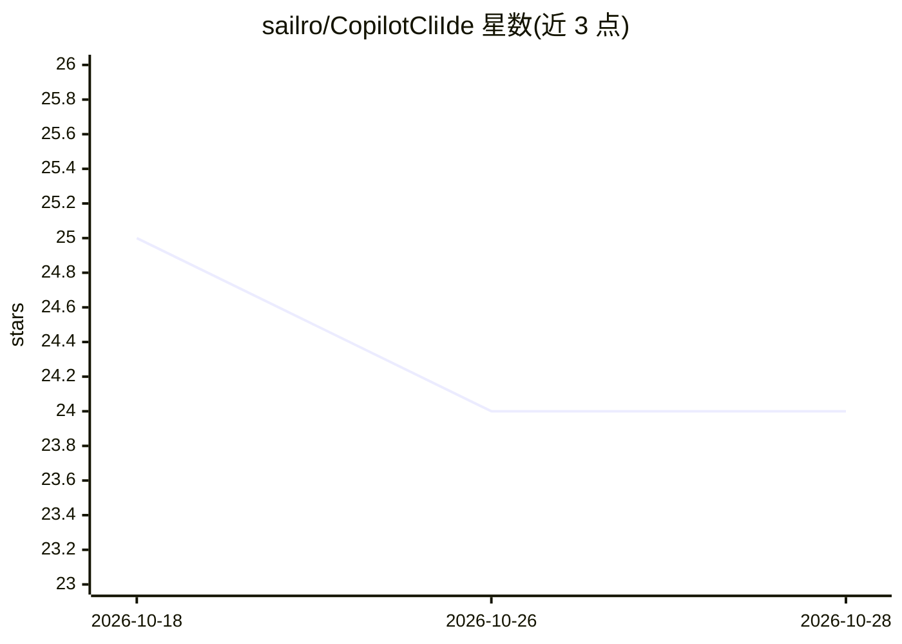

# sailro/CopilotCliIde

⭐ 24 · C# · MIT · 推送 2026-04-28 · [GitHub](https://github.com/sailro/CopilotCliIde) · 个人维护

**让 GitHub Copilot CLI 通过 /ide 连接 Visual Studio 的扩展桥**

Visual Studio 扩展，使 GitHub Copilot CLI 能像在 VS Code 中一样通过 /ide 命令连接 Visual Studio。架构为三层：net472 的 VS 扩展管理连接生命周期、订阅编辑器事件并提供内嵌终端（Microsoft.Terminal.Wpf + ConPTY）；net10.0 的 ASP.NET Core 进程经 Windows 命名管道承载 MCP 服务器（ModelContextProtocol.AspNetCore/Kestrel，含 7 个 MCP 工具）；共享层定义 RPC 契约。连接后 agent 可查询解决方案信息、实时查看选区、以 Accept/Reject 方式提出 diff、读取错误列表诊断。需自行用 MSBuild 编译生成 vsix 安装。

## 筛选速览

| 维度 | 判定 | 备注 |
|---|---|---|
| AI 角色 | `ai-ecosystem` | LLM/agent 周边工具 |
| 许可风险 | `permissive` | MIT |
| 部署形态 | `desktop` | 安装包/桌面程序 |
| 模型依赖 | — | README 未给出锁定关系 |
| 硬件要求 | — | 无带数字的原话,不猜 |
| 安装摩擦 | `high` | 编译与系统依赖俱全 |
| 成熟度 | — | 结构信号不足 |

## 能力要点

- 通过 /ide 命令让 Copilot CLI 发现并连接 Visual Studio
- MCP 服务器承载于 Windows 命名管道上的 ASP.NET Core/Kestrel 进程，含 7 个 MCP 工具
- 支持内嵌可停靠终端或外置终端两种运行方式
- 连接后可实时同步选区、提出 diff（Accept/Reject）并读取 Error List 诊断

## 适用场景

- 在 Visual Studio 中以 /ide 方式接入 Copilot CLI 作为编码 agent
- 把 Copilot CLI 作为可停靠窗口嵌入 VS 编辑器旁
- 调试 CLI 与 IDE 的桥接活动（专用 Output 日志面板）

## 场景标签

`编码 Agent` · 领域:编码与开发

## 证据(README 行号)

> L4: A Visual Studio extension that enables GitHub Copilot CLI to interact with Visual Studio via the `/ide` command — th
> L6: The MCP server uses **ModelContextProtocol.AspNetCore** with Kestrel hosting over a Windows named pipe — ASP.NET Cor
> L80: - **CopilotCliIde.Server** (`net10.0`) — ASP.NET Core (Kestrel) process hosting the MCP server on a Windows named p

## 星数曲线

2026-10-18 25 → 2026-10-28 24（-1）

---
*卡片 v1 · prompt 1.4 · 生成 2026-10-27 · 置信度 high · 依据 README sha `d16be4a9dff3` · [字段定义](../../DATASET.md)*
