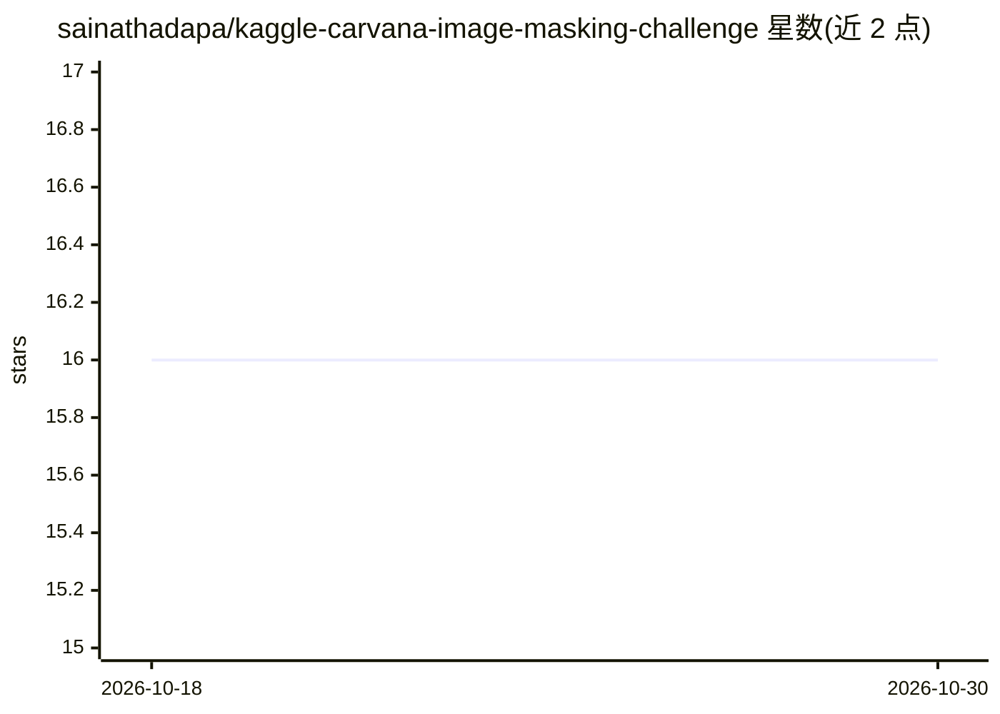

# sainathadapa/kaggle-carvana-image-masking-challenge

⭐ 16 · Jupyter Notebook · MIT · 推送 2026-09-04 · [GitHub](https://github.com/sainathadapa/kaggle-carvana-image-masking-challenge) · [官网](https://www.kaggle.com/c/carvana-image-masking-challenge) · 个人维护

**Kaggle Carvana 图像分割竞赛的个人参赛代码与实验记录**

作者参加 Kaggle Carvana Image Masking Challenge（车辆图像背景分割）的个人代码仓库，最终成绩位列 Private Leaderboard 前 15%。内容以一系列 Jupyter notebook 组织：从数据探索、多种分辨率的 U-Net 训练（128x128 至 1920x1280）、Tiramisu 与 InceptionV3 变体实验、边界框裁剪策略、阈值分析，到多模型集成，并附各 notebook 的训练/验证 loss、dice 系数与公榜成绩。集成模型 Private LB dice 为 0.9965。

## 筛选速览

| 维度 | 判定 | 备注 |
|---|---|---|
| AI 角色 | `ai-native` | 本体是模型或模型工具 |
| 许可风险 | `permissive` | MIT |
| 部署形态 | `None` |  |
| 模型依赖 | — | README 未给出锁定关系 |
| 硬件要求 | — | 无带数字的原话,不猜 |
| 安装摩擦 | `low` | 无编译、无系统依赖或容器化 |
| 成熟度 | — | 结构信号不足 |

## 能力要点

- 记录多组不同分辨率与架构变体的 U-Net 实验及其成绩
- 包含边界框裁剪、图像切块、阈值分析等预处理与后处理策略
- 两版集成 notebook 通过平均预测融合模型
- 最终集成模型 Private LB dice 0.9965

## 适用场景

- 学习 Kaggle 语义分割竞赛的完整实验流程
- 参考 U-Net 不同分辨率与架构变体的实现
- 借鉴图像切块与模型集成的竞赛技巧

## 场景标签

`目标检测` · 领域:感知与多模态

## 证据(README 行号)

> L1: This repository contains my personal code for the Kaggle competition - Carvana Image Masking Challenge.
> L26: The Private Leaderboard score for the Ensemble model was 0.9965.

## 星数曲线

2026-10-18 16 → 2026-10-30 16（+0）

---
*卡片 v1 · prompt 1.4 · 生成 2026-10-30 · 置信度 high · 依据 README sha `f3b9cb26cea3` · [字段定义](../../DATASET.md)*
