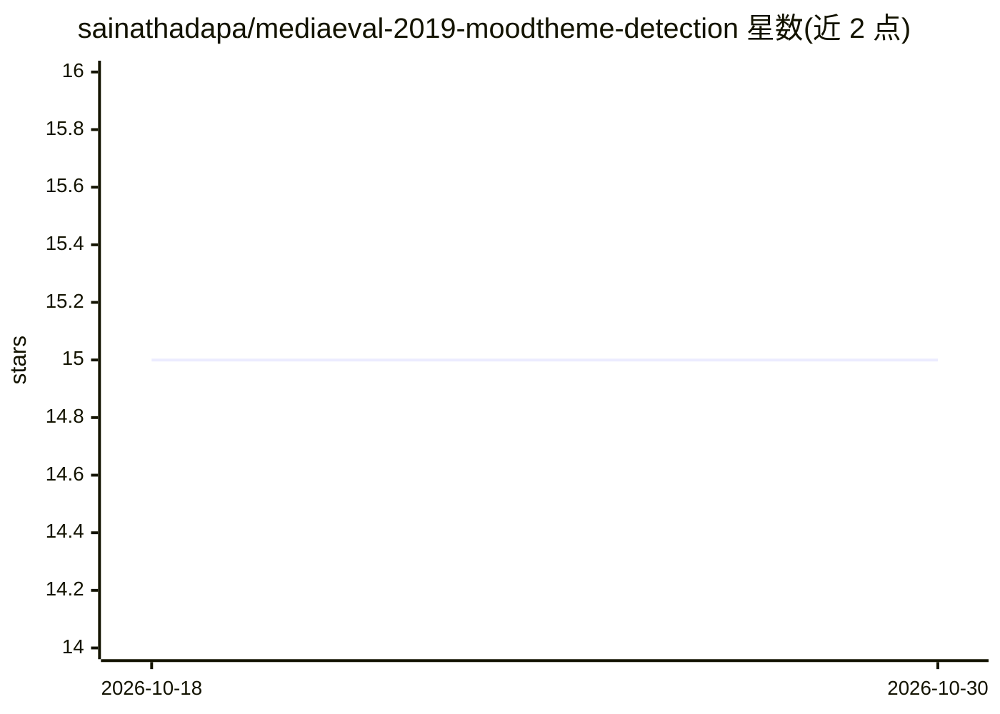

# sainathadapa/mediaeval-2019-moodtheme-detection

⭐ 15 · Jupyter Notebook · MIT · 推送 2026-09-04 · [GitHub](https://github.com/sainathadapa/mediaeval-2019-moodtheme-detection) · 个人维护

**MediaEval 2019 音乐情绪与主题识别任务的竞赛方案（第 4 名）**

该仓库是 MediaEval 2019 "Emotion and Themes in Music using Jamendo" 任务的第 4 名解决方案，基于深度学习对音乐音频做多标签情绪与主题分类。提供两个提交方案：submission1 为 MobileNetV2 加数据增强，submission2 在此基础上增加 Self Attention。方法细节写在报告中，提交文件位于 submission 文件夹，结果可在任务官网查询。README 未给出安装运行命令与系统依赖。

## 筛选速览

| 维度 | 判定 | 备注 |
|---|---|---|
| AI 角色 | `ai-native` | 本体是模型或模型工具 |
| 许可风险 | `permissive` | MIT |
| 部署形态 | `None` |  |
| 模型依赖 | — | README 未给出锁定关系 |
| 硬件要求 | — | 无带数字的原话,不猜 |
| 安装摩擦 | `low` | 无编译、无系统依赖或容器化 |
| 成熟度 | — | 结构信号不足 |

## 能力要点

- MediaEval 2019 音乐情绪与主题识别任务第 4 名方案
- submission1：MobileNetV2 + 数据增强
- submission2：MobileNetV2 + 数据增强 + Self Attention

## 适用场景

- 复现音乐情绪/主题多标签分类的竞赛基线
- 参考 MobileNetV2 与 Self Attention 在音频分类中的用法

## 场景标签

 · 领域:音频/音乐信息检索

## 证据(README 行号)

> L1: # Solution to the "MediaEval - The 2019 Emotion and Themes in Music using Jamendo" task
> L17: - submission1 - MobilenetV2 + Data Augmentation
> L18: - submission2 - MobilenetV2 + Data Augmentation + Self Attention

## 星数曲线

2026-10-18 15 → 2026-10-30 15（+0）

---
*卡片 v1 · prompt 1.4 · 生成 2026-10-30 · 置信度 high · 依据 README sha `e5a1559fe278` · [字段定义](../../DATASET.md)*
