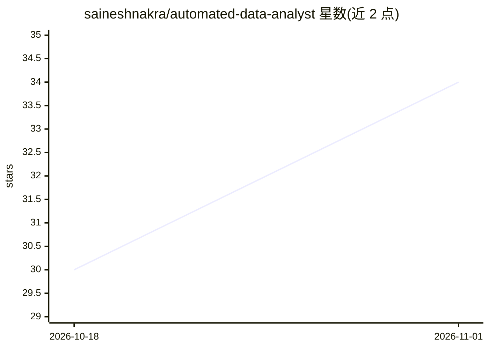

# saineshnakra/automated-data-analyst

⭐ 34 · Python · MIT · 推送 2026-10-31 · [GitHub](https://github.com/saineshnakra/automated-data-analyst) · [官网](https://automated-data-analyst.streamlit.app/) · 个人维护

**给 LLM 提供数值计算与核验的工具包：用 pandas/SciPy/statsmodels 算数并验证声明**

ADA 是 Python 包、命令行和函数调用工具定义集，供 Claude Code、Codex 及本地模型（Ollama/llama.cpp/vLLM/LM Studio）调用。指向 CSV/Excel 数据后用 pandas、SciPy、statsmodels 计算答案并返回数字、计算过程与所涉行，或给出拒绝原因；可核验关于数据的数字声明（verified/unverified）。另提供文件夹扫描、Kaggle 式表格预测（ada model/auto，LightGBM/XGBoost 等融合）、--explain 可读模型、论文表格与图表生成。限制：三文件连接、多种表述等场景尚未覆盖。

## 筛选速览

| 维度 | 判定 | 备注 |
|---|---|---|
| AI 角色 | `ai-ecosystem` | LLM/agent 周边工具 |
| 许可风险 | `permissive` | MIT |
| 部署形态 | `library` | 以包/库形式分发 |
| 模型依赖 | local-ok | 支持本地模型 |
| 硬件要求 | — | 无带数字的原话,不猜 |
| 安装摩擦 | `low` | 无编译、无系统依赖或容器化 |
| 成熟度 | — | 结构信号不足 |

## 能力要点

- 四个函数调用工具：ask/check a claim/scan/model，OpenAI 兼容格式
- 核验数字声明并给出计算、行数与拒绝原因
- ada model/auto 做表格列预测，LightGBM/XGBoost/CatBoost 等融合，交叉验证
- ada build 生成论文资产：数据字典、Word/LaTeX/CSV 结果表、图与方法草稿

## 适用场景

- 让 Claude Code/Codex 等助手用 ADA 做数据计算与数字核验
- 本地小模型通过工具调用完成数据分析
- 核验报告或 LLM 回答中关于数据的数字是否成立
- 自动参加 Kaggle 表格竞赛或生成论文结果表

## 场景标签

`数据分析` `科研工具` · 领域:效率与自动化

## 证据(README 行号)

> L28: answer. ADA is a Python package, a command line and a set of tool
> L40: tools.definitions()                    # four tools for function calling: ask, check a claim, scan, model

## 星数曲线

2026-10-18 30 → 2026-11-01 34（+4）

---
*卡片 v1 · prompt 1.4 · 生成 2026-10-31 · 置信度 high · 依据 README sha `e5b7c6d45814` · [字段定义](../../DATASET.md)*
