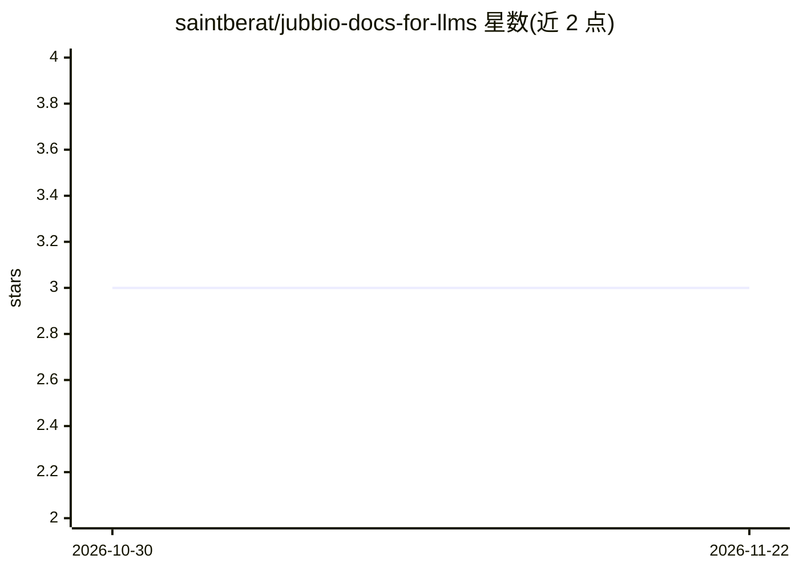

# saintberat/jubbio-docs-for-llms

⭐ 3 · MIT · 推送 2026-11-21 · [GitHub](https://github.com/saintberat/jubbio-docs-for-llms) · 个人维护

**为 LLM 与 AI agent 提供的 Jubbio 平台开发者文档库**

面向 Jubbio 实时消息平台的开发者文档仓库，以机器可读格式提供技术参考：JUBBIO_DEV_REFERENCE.md 主参考（10 个模块：认证、消息、频道、OAuth2、Webhook、语音、分片等）、llms.txt 索引与 llms-full.txt 全文。README 说明用途是弥补预训练模型缺失 Jubbio 端点与 schema 知识的空白，并给出在 Cursor/Windsurf、Claude Projects、Custom GPT 及系统提示中接入的具体方法。

## 筛选速览

| 维度 | 判定 | 备注 |
|---|---|---|
| AI 角色 | `ai-knowledge` | 知识聚合/清单类 |
| 许可风险 | `permissive` | MIT |
| 部署形态 | `library` | 以包/库形式分发 |
| 模型依赖 | — | README 未给出锁定关系 |
| 硬件要求 | — | 无带数字的原话,不猜 |
| 安装摩擦 | `low` | 无编译、无系统依赖或容器化 |
| 成熟度 | `idea` | |

## 能力要点

- 提供 llms.txt / llms-full.txt 机器可读文档格式
- 主参考覆盖 10 个模块（认证、消息、OAuth2、Webhook、语音等）
- 给出 REST/WebSocket/OAuth2 端点速查表
- 提供三种 AI 工具接入方式（IDE 文档索引、知识库上传、系统提示）

## 适用场景

- 让 AI 编码助手生成符合 Jubbio API 规范的机器人代码
- 在 Claude Project 或 Custom GPT 知识库中接入 Jubbio 文档
- 为 bot 开发查询 Jubbio 端点、payload 与权限模型

## 场景标签

 · 领域:开发者文档/知识库

## 证据(README 行号)

> L1: # Jubbio Developer Documentation for LLMs & AI Agents
> L8: **A comprehensive technical reference repository optimized for Large Language Models (LLMs), AI coding assistants, a
> L18: **This repository bridges that gap:** It provides an authoritative, machine-readable, verified technical reference 

## 星数曲线

2026-10-30 3 → 2026-11-22 3（+0）

---
*卡片 v1 · prompt 1.4 · 生成 2026-11-21 · 置信度 mid · 依据 README sha `ca9da5632128` · [字段定义](../../DATASET.md)*
