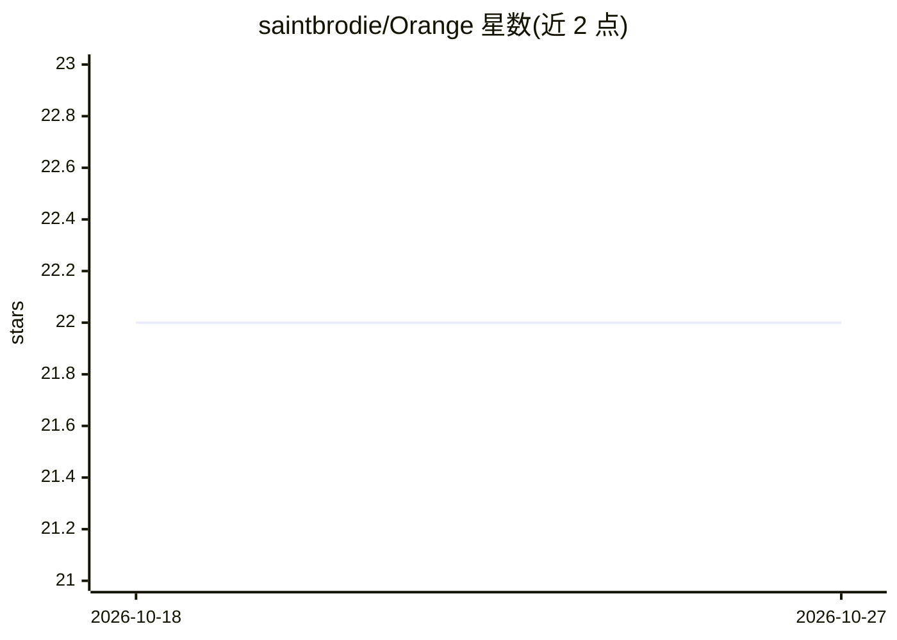

# saintbrodie/Orange

⭐ 22 · Python · MIT · 推送 2026-10-02 · [GitHub](https://github.com/saintbrodie/Orange) · 个人维护

**ComfyUI 工作流的简化 Web 前端：把节点图变成简单工具**

面向使用者的 ComfyUI Web 前端：将已完成的 ComfyUI 工作流封装为隐藏节点图与模型配置的简单生成工具，支持图像生成、编辑、放大、视频、音频与文本工作流。提供工具使用前的节点/模型/资产预检，并将任务路由到兼容的 ComfyUI 后端。安装方式为 Pinokio 启动器（可一并安装 ComfyUI 或连接既有实例）或手动克隆仓库运行脚本，需 Python 3 与可达的 ComfyUI 实例。另含可选 LLM 提示词增强与白标定制。MIT 许可。

## 筛选速览

| 维度 | 判定 | 备注 |
|---|---|---|
| AI 角色 | `ai-ecosystem` | LLM/agent 周边工具 |
| 许可风险 | `permissive` | MIT |
| 部署形态 | `None` |  |
| 模型依赖 | — | README 未给出锁定关系 |
| 硬件要求 | — | 无带数字的原话,不猜 |
| 安装摩擦 | `low` | 无编译、无系统依赖或容器化 |
| 成熟度 | — | 结构信号不足 |

## 能力要点

- 将 ComfyUI API 格式工作流转为隐藏节点图的简单工具界面
- 预检节点、模型、映射与资产并路由到兼容后端
- 支持图像、编辑、放大、视频、音频、文本等多类工作流
- 可选本地或云端 LLM 提示词增强与白标品牌定制

## 适用场景

- 把搭好的 ComfyUI 工作流交付给不熟悉节点图的人使用
- 用简明界面做图像生成、编辑与放大
- 通过 Pinokio 一键安装并管理本地 ComfyUI 与前端

## 场景标签

`图像生成` · 领域:内容生成

## 证据(README 行号)

> L5: Orange is a small web frontend for **ComfyUI**. It turns finished ComfyUI workflows into simple tools that people ca
> L15: - **Preflight and routing.** Check nodes, models, mappings, and assets before a tool is used, then route jobs to co

## 星数曲线

2026-10-18 22 → 2026-10-27 22（+0）

---
*卡片 v1 · prompt 1.4 · 生成 2026-10-27 · 置信度 high · 依据 README sha `2158b825f2f2` · [字段定义](../../DATASET.md)*
