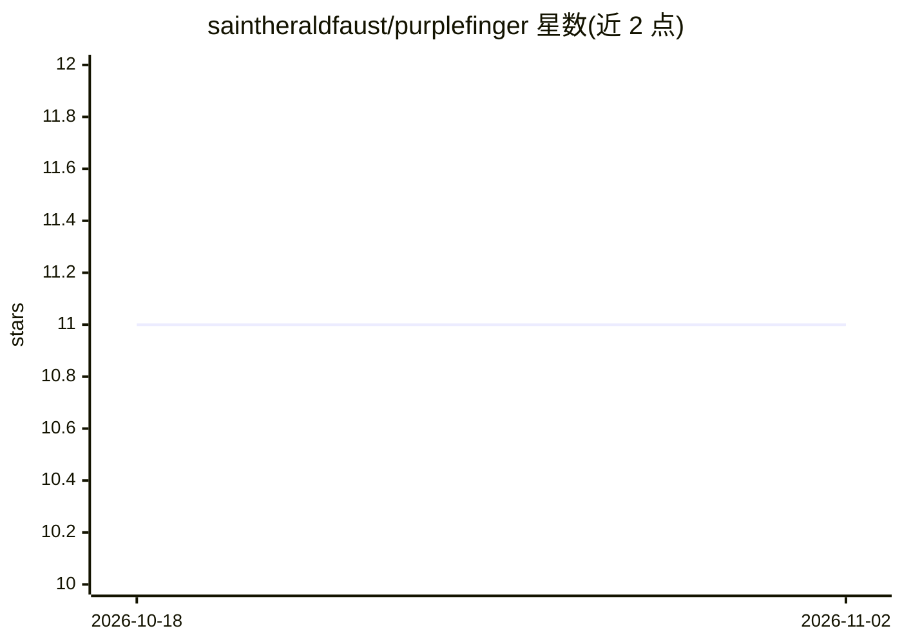

# saintheraldfaust/purplefinger

⭐ 11 · JavaScript · AGPL-3.0 · 推送 2026-07-18 · [GitHub](https://github.com/saintheraldfaust/purplefinger) · 个人维护

**实时人脸替换流式系统：轻客户端+远程 GPU 推理节点**

将采集与推理解耦的实时换脸系统：Electron 桌面客户端负责摄像头采集、JPEG 编码与显示，经 WebSocket 把帧发送到运行 InsightFace inswapper_128 推理管线的 GPU 节点（Docker 分发，HTTP/WebSocket 端口 8765），GPU 节点可选 GFPGAN/CodeFormer 增强、TensorRT FP16 加速，返回帧以本地 OBS Browser Source 形式暴露为虚拟摄像头。客户端无需 GPU，节点可在本地或按会话租用云端 NVIDIA 实例。AGPL-3.0 许可，声明仅限经同意的娱乐/表演/特效/研究用途。

## 筛选速览

| 维度 | 判定 | 备注 |
|---|---|---|
| AI 角色 | `ai-native` | 本体是模型或模型工具 |
| 许可风险 | `viral` | AGPL-3.0 |
| 部署形态 | `self-host` | docker 或自建部署 |
| 模型依赖 | — | README 未给出锁定关系 |
| 硬件要求 | `cpu-ok` | |
| 安装摩擦 | `low` | 无编译、无系统依赖或容器化 |
| 成熟度 | — | 结构信号不足 |

## 能力要点

- 客户端/GPU 节点分离架构，客户端无 GPU 依赖，经 WebSocket 传输 JPEG 帧
- InsightFace inswapper_128 换脸，GFPGAN/CodeFormer 增强，TensorRT FP16 加速与引擎缓存
- 输出为 OBS Browser Source 虚拟摄像头，可被会议/直播/录制软件使用
- GPU 节点以 Docker 镜像分发，支持按会话临时云实例（如 RunPod）

## 适用场景

- 直播或视频会议中把摄像头画面实时替换为指定人脸
- 本地无 GPU 的机器借助远程/云端 GPU 节点运行实时换脸
- 录制或表演场景中以虚拟摄像头输出换脸流

## 场景标签

`图像视频处理` · 领域:感知与多模态

## 证据(README 行号)

> L5: Purplefinger is a real-time face-swap system that decouples capture and display
> L46: - **Detection + swap** — InsightFace `inswapper_128` via `onnxruntime-gpu`.

## 星数曲线

2026-10-18 11 → 2026-11-02 11（+0）

---
*卡片 v1 · prompt 1.4 · 生成 2026-11-01 · 置信度 high · 依据 README sha `7a7d9ccb249b` · [字段定义](../../DATASET.md)*
