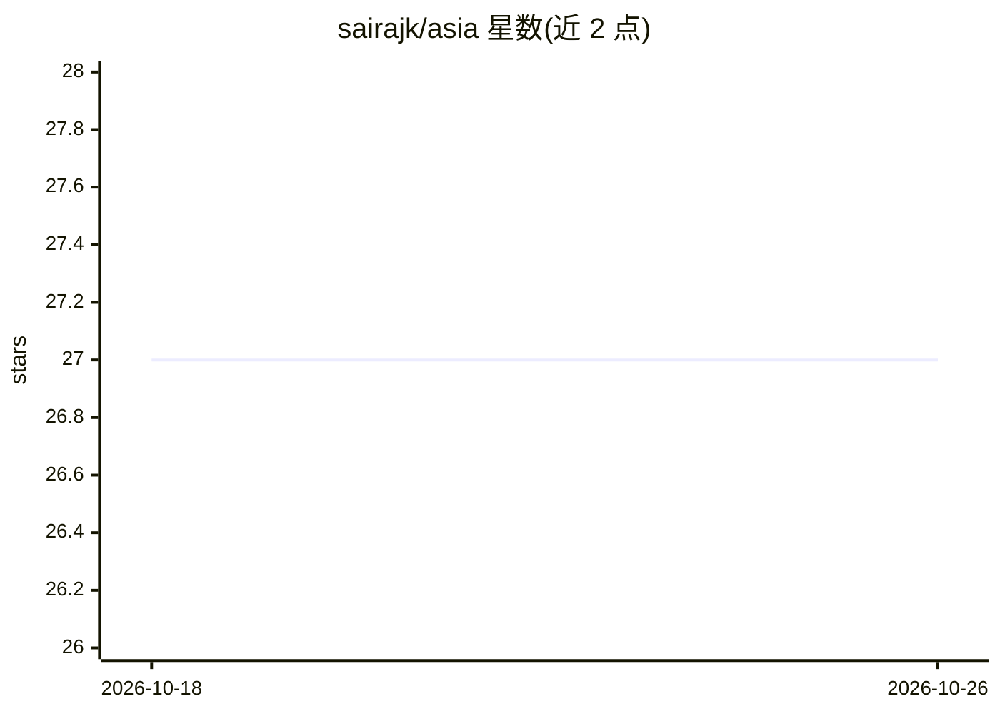

# sairajk/asia

⭐ 27 · 推送 2026-02-14 · [GitHub](https://github.com/sairajk/asia) · [官网](https://sairajk.github.io/asia/) · 组织维护

**少样本图像标注驱动的自适应 3D 网格分割框架（SIGGRAPH Asia 2025 论文）**

SIGGRAPH Asia 2025 论文项目的官方仓库。ASIA 框架利用文本到图像扩散模型（如 Stable Diffusion）的先验，将少量用户标注的图像分割迁移到 3D：训练时为每个分割片段优化文本 token 并使用跨视角部件对应损失微调；推理时对网格的多视角渲染进行分割，在 UV 空间融合标签，再经 Noise Optimization 精化并映射回网格。面向科研用户。代码尚未发布（'Code will be released soon'）。

## 筛选速览

| 维度 | 判定 | 备注 |
|---|---|---|
| AI 角色 | `ai-native` | 本体是模型或模型工具 |
| 许可风险 | `none` | — |
| 部署形态 | `None` |  |
| 模型依赖 | — | README 未给出锁定关系 |
| 硬件要求 | — | 无带数字的原话,不猜 |
| 安装摩擦 | `low` | 无编译、无系统依赖或容器化 |
| 成熟度 | — | 结构信号不足 |

## 能力要点

- 少样本图像标注控制 3D 部件分割（支持非语义、非文本可描述部件）
- 基于 Stable Diffusion 先验将图像分割迁移到 3D
- 跨视角部件对应损失与 UV 空间标签融合、Noise Optimization 精化

## 适用场景

- 对 3D 网格做语义或非语义的部件级分割
- 仅用少量图像标注控制分割对象
- 复现或跟进该 SIGGRAPH Asia 2025 论文方法

## 场景标签

`科研工具` · 领域:学习与行业

## 证据(README 行号)

> L23: We introduce ASIA (Adaptive 3D Segmentation using few Image Annotations), a novel framework that enables segmentati

## 星数曲线

2026-10-18 27 → 2026-10-26 27（+0）

---
*卡片 v1 · prompt 1.4 · 生成 2026-10-26 · 置信度 high · 依据 README sha `1b4669ab8d4b` · [字段定义](../../DATASET.md)*
