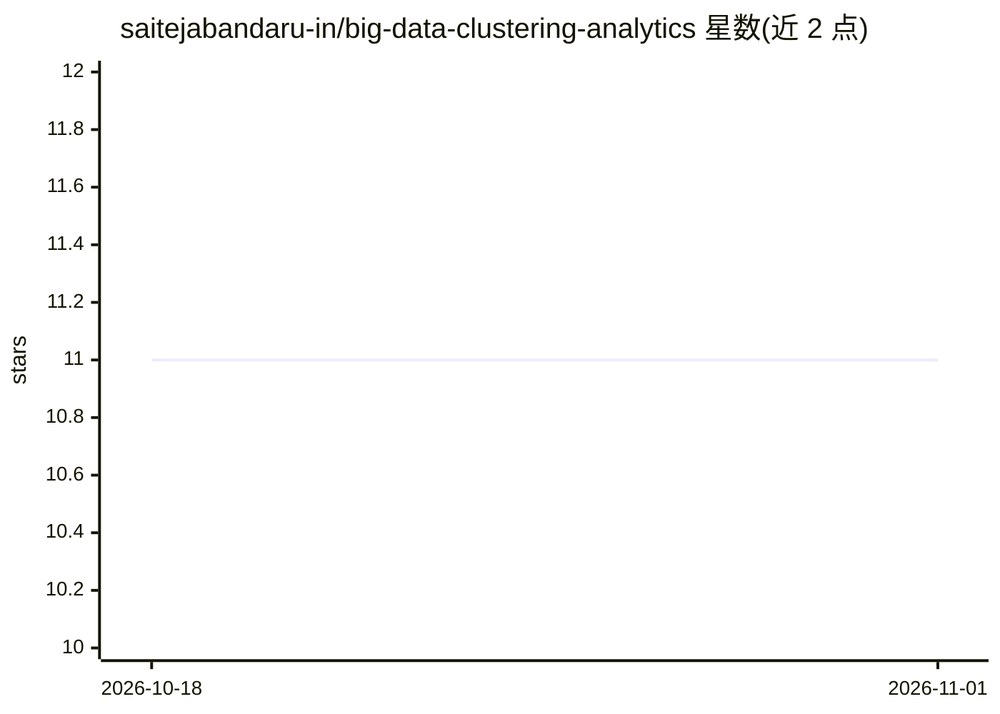

# saitejabandaru-in/big-data-clustering-analytics

⭐ 11 · Python · MIT · 推送 2026-07-16 · [GitHub](https://github.com/saitejabandaru-in/big-data-clustering-analytics) · 个人维护

**面向大数据的可扩展聚类框架，应用于出租车出行与欺诈检测**

Python 实现的聚类算法集合，覆盖划分式（Mini-Batch KMeans++、CLARA、CLARANS）、层次式（BIRCH、CURE）、密度式（DBSCAN、OPTICS、DENCLUE）与网格式（STING）四类，每个算法为独立 Python 文件，可直接运行完整流水线。应用于两个 Kaggle 公开数据集：NYC 出租车出行的城市移动模式分析与信用卡交易（284,807 条、0.17% 欺诈）的异常检测。使用 Silhouette、Davies–Bouldin、ARI、Entropy 评估聚类质量；数据集因 Kaggle 许可不入库，需自行下载放入 data/raw/。

## 筛选速览

| 维度 | 判定 | 备注 |
|---|---|---|
| AI 角色 | `ai-native` | 本体是模型或模型工具 |
| 许可风险 | `permissive` | MIT |
| 部署形态 | `library` | 以包/库形式分发 |
| 模型依赖 | — | README 未给出锁定关系 |
| 硬件要求 | — | 无带数字的原话,不猜 |
| 安装摩擦 | `low` | 无编译、无系统依赖或容器化 |
| 成熟度 | — | 结构信号不足 |

## 能力要点

- 四类共 10 种聚类算法，每算法独立文件运行完整流水线
- 应用于 NYC 出租车出行模式与信用卡欺诈异常检测
- 提供 Silhouette / Davies–Bouldin / ARI / Entropy 聚类质量评估

## 适用场景

- 在大规模出行数据上发现高需求路线与移动模式
- 将稀疏聚类用于无标签交易的欺诈异常检测
- 对比不同可扩展聚类算法在同一数据集上的表现

## 场景标签

`数据分析` · 领域:效率与自动化

## 证据(README 行号)

> L11: The goal is to show how **modern clustering algorithms** such as **KMeans++, DBSCAN, OPTICS, BIRCH, and DENCLUE** p
> L54: ## ⚙️ Algorithms Implemented

## 星数曲线

2026-10-18 11 → 2026-11-01 11（+0）

---
*卡片 v1 · prompt 1.4 · 生成 2026-11-01 · 置信度 high · 依据 README sha `9a8327ccd3f1` · [字段定义](../../DATASET.md)*
