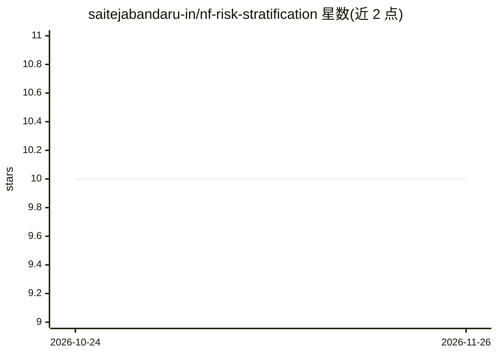

# saitejabandaru-in/nf-risk-stratification

⭐ 10 · Python · NOASSERTION · 推送 2026-07-16 · [GitHub](https://github.com/saitejabandaru-in/nf-risk-stratification) · [官网](https://www.researchgate.net/publication/395295598_Permutation-Based_Analysis_of_Clinical_Variables_in_Necrotizing_Fasciitis_Using_NPC_and_Bootstrap) · 个人维护

**为坏死性筋膜炎临床数据提供风险分层统计工具（Python/R）**

提供 Python 与 R 两套工具，用于坏死性筋膜炎的可复现临床风险分层：支持描述性统计、Fisher/Tippett/Liptak 非参数组合检验、bootstrap 置信区间及患者严重程度排序。因伦理与隐私限制不含真实临床数据，用户需自备匿名化 CSV（必需 HBA1C、ALBUMINA 列）；附示例玩具数据集，并保留调用包函数的遗留 R 脚本。方法学与 2025 年发表的 NPC/Bootstrap 论文对齐。

## 筛选速览

| 维度 | 判定 | 备注 |
|---|---|---|
| AI 角色 | `ai-native` | 本体是模型或模型工具 |
| 许可风险 | `none` | NOASSERTION |
| 部署形态 | `desktop` | 安装包/桌面程序 |
| 模型依赖 | — | README 未给出锁定关系 |
| 硬件要求 | — | 无带数字的原话,不猜 |
| 安装摩擦 | `low` | 无编译、无系统依赖或容器化 |
| 成熟度 | `idea` | |

## 能力要点

- Python 与 R 双语言包，run_nf_pipeline 一键跑完整流程
- Fisher/Tippett/Liptak NPC 全局 p 值与 bootstrap 置信区间
- 按综合临床严重程度对患者排序
- 自动发布工作流：tag 触发 GitHub Actions 构建源码包

## 适用场景

- 对匿名化的坏死性筋膜炎临床数据做非参数组合检验
- 计算患者严重程度排序辅助临床分层研究
- 复现论文中的 NPC/Bootstrap 分析方法

## 场景标签

`科研工具` · 领域:学习与行业

## 证据(README 行号)

> L5: `nf-risk-stratification` provides Python and R tooling for reproducible clinical
> L7: summaries, partial tests, Fisher/Tippett/Liptak nonparametric combination
> L8: methods, bootstrap confidence intervals, and patient severity ranking.

## 星数曲线

2026-10-24 10 → 2026-11-26 10（+0）

---
*卡片 v1 · prompt 1.4 · 生成 2026-11-19 · 置信度 high · 依据 README sha `3ae593db7bb3` · [字段定义](../../DATASET.md)*
