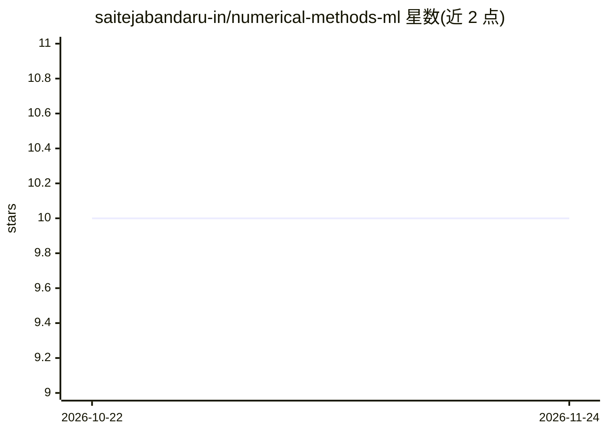

# saitejabandaru-in/numerical-methods-ml

⭐ 10 · MATLAB · MIT · 推送 2026-05-29 · [GitHub](https://github.com/saitejabandaru-in/numerical-methods-ml) · 个人维护

**用 MATLAB 从数学原理实现 PCA/LDA/NMF/K-Means 并可视化**

以经典 Iris 数据集为对象的 MATLAB 教学演示项目：从线性代数与数值优化角度自行实现 PCA、LDA、NMF 与 K-Means 四种方法，不依赖黑盒机器学习库；每个脚本输出数值结果与可视化图像（投影、类分离、潜在成分、聚类），结果存于 results/ 目录。运行需 MATLAB 环境，README 给出的步骤为打开 MATLAB、设工作目录后运行 fullcode 或逐个运行脚本。定位为展示机器学习数学原理的学习型代码库。

## 筛选速览

| 维度 | 判定 | 备注 |
|---|---|---|
| AI 角色 | `ai-native` | 本体是模型或模型工具 |
| 许可风险 | `permissive` | MIT |
| 部署形态 | `None` |  |
| 模型依赖 | — | README 未给出锁定关系 |
| 硬件要求 | — | 无带数字的原话,不猜 |
| 安装摩擦 | `low` | 无编译、无系统依赖或容器化 |
| 成熟度 | — | 结构信号不足 |

## 能力要点

- PCA/LDA/NMF/K-Means 四种方法的 MATLAB 从零实现
- 每个脚本同时产出数值输出与可视化结果
- 数据集以 data/iris.mat 格式随仓库提供

## 适用场景

- 学习 PCA、LDA、NMF、K-Means 的数学实现细节
- 教学场景中演示降维与聚类在 Iris 数据上的效果

## 场景标签

`教程课程` · 领域:学习与行业

## 证据(README 行号)

> L24: |**PCA (Principal Component Analysis)**|Reduce dimensionality and reveal variance structure|
> L64: matlab/     → MATLAB implementations of PCA, LDA, NMF, and K-Means
> L87: Each script produces numerical output and visualizations.

## 星数曲线

2026-10-22 10 → 2026-11-24 10（+0）

---
*卡片 v1 · prompt 1.4 · 生成 2026-11-19 · 置信度 high · 依据 README sha `f12e20e55825` · [字段定义](../../DATASET.md)*
