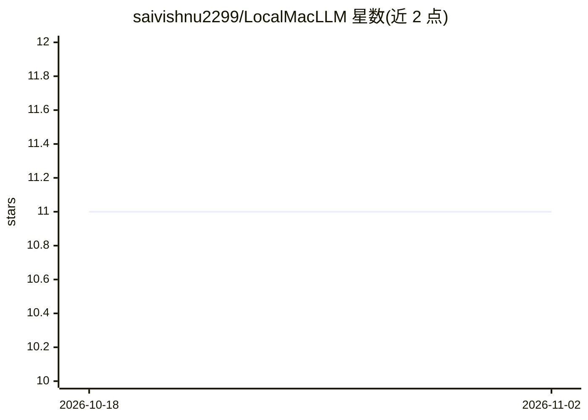

# saivishnu2299/LocalMacLLM

⭐ 11 · Python · 推送 2026-01-06 · [GitHub](https://github.com/saivishnu2299/LocalMacLLM) · 个人维护

**在 MacBook 上用 MLX 从零训练 1.5M 参数 GPT 模型的教学项目**

面向 Apple Silicon Mac（M1/M2/M3，macOS≥13.5）的端到端小型语言模型实现：从下载 TinyStories 数据集（约 2000 万 token）、训练 SentencePiece BPE 分词器、训练约 150 万参数的 GPT 风格 transformer，到生成交互式短故事文本。M1 Pro 上训练耗时 5-10 分钟，验证困惑度约 9-15。项目自述为教育/实验性质，用于学习 LLM 的完整构建流程，含快速训练脚本与故障排查指南。

## 筛选速览

| 维度 | 判定 | 备注 |
|---|---|---|
| AI 角色 | `ai-native` | 本体是模型或模型工具 |
| 许可风险 | `none` | — |
| 部署形态 | `library` | 以包/库形式分发 |
| 模型依赖 | — | README 未给出锁定关系 |
| 硬件要求 | — | 无带数字的原话,不猜 |
| 安装摩擦 | `low` | 无编译、无系统依赖或容器化 |
| 成熟度 | — | 结构信号不足 |

## 能力要点

- 完整流水线：数据下载→BPE 分词器训练→transformer 训练→文本生成
- 约 1.5M 参数（7 层、d_model 128、词表 1024、上下文 256）
- M1 Pro 上 5-10 分钟训练完成，16GB 内存可容纳
- 支持检查点保存、困惑度评估与训练中采样

## 适用场景

- 学习从零构建 LLM 的完整流程
- 在消费级 MacBook 上快速跑通模型训练实验
- 生成简单连贯的短故事验证模型效果

## 场景标签

`模型训练` `教程课程` · 领域:学习与行业

## 证据(README 行号)

> L5: A complete, end-to-end implementation of a tiny language model that demonstrates the full pipeline from raw text dat
> L26: - **Model**: GPT-style transformer with ~1.5M parameters
> L109: ```bash

## 星数曲线



2026-10-18 11 → 2026-11-02 11（+0）


---
*卡片 v1 · prompt 1.4 · 生成 2026-11-01 · 置信度 mid · 依据 README sha `40e917e01dd6` · [字段定义](../../DATASET.md)*
