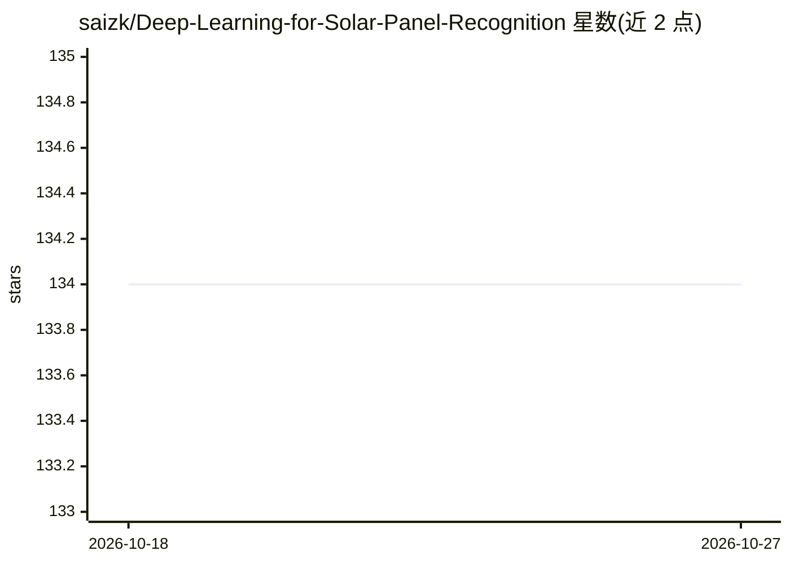

# saizk/Deep-Learning-for-Solar-Panel-Recognition

⭐ 134 · Jupyter Notebook · MIT · 推送 2026-02-20 · [GitHub](https://github.com/saizk/Deep-Learning-for-Solar-Panel-Recognition) · 个人维护

**航拍图像光伏板检测与分割的 CNN 代码库**

面向光伏板识别的深度学习项目：用 YOLOv5（S/M/L/X 四种规模）做目标检测，用 Unet++、FPN、DeepLabV3+、PSPNet 做图像分割，基于 PyTorch 与 segmentation_models.pytorch 实现。提供数据预处理、训练与推理脚本，分割部分通过 Jupyter notebook 运行。数据来源包括 Zenodo 光伏数据集、Google Maps API/网页抓取与 Sentinel-2 下载器（后者标注未使用）。需要 Python 3.8 与 PyTorch CUDA 11.3 环境。

## 筛选速览

| 维度 | 判定 | 备注 |
|---|---|---|
| AI 角色 | `ai-native` | 本体是模型或模型工具 |
| 许可风险 | `permissive` | MIT |
| 部署形态 | `library` | 以包/库形式分发 |
| 模型依赖 | — | README 未给出锁定关系 |
| 硬件要求 | — | 无带数字的原话,不猜 |
| 安装摩擦 | `medium` | 含编译或系统依赖之一 |
| 成熟度 | — | 结构信号不足 |

## 能力要点

- YOLOv5 四种规模模型的目标检测训练与推理脚本
- Unet++/FPN/DeepLabV3+/PSPNet 四种分割架构
- Google Maps API 与网页抓取的航拍图像下载器
- 基于 PyTorch Lightning 与 vanilla PyTorch 的分割 notebook

## 适用场景

- 在航拍或卫星图像中检测并分割光伏板
- 复现或比较不同检测/分割架构在光伏数据集上的表现
- 获取 Google Maps 航拍图像用于光伏相关研究

## 场景标签

`目标检测` · 领域:感知与多模态

## 证据(README 行号)

> L3: Recognition of photovoltaic cells in aerial images with **Convolutional Neural Networks** (CNNs).
> L4: **Object detection** with YOLOv5 models and **image segmentation** with Unet++, FPN, DLV3+ and PSPNet.

## 星数曲线

2026-10-18 134 → 2026-10-27 134（+0）

---
*卡片 v1 · prompt 1.4 · 生成 2026-10-22 · 置信度 high · 依据 README sha `a0c5398e1c88` · [字段定义](../../DATASET.md)*
