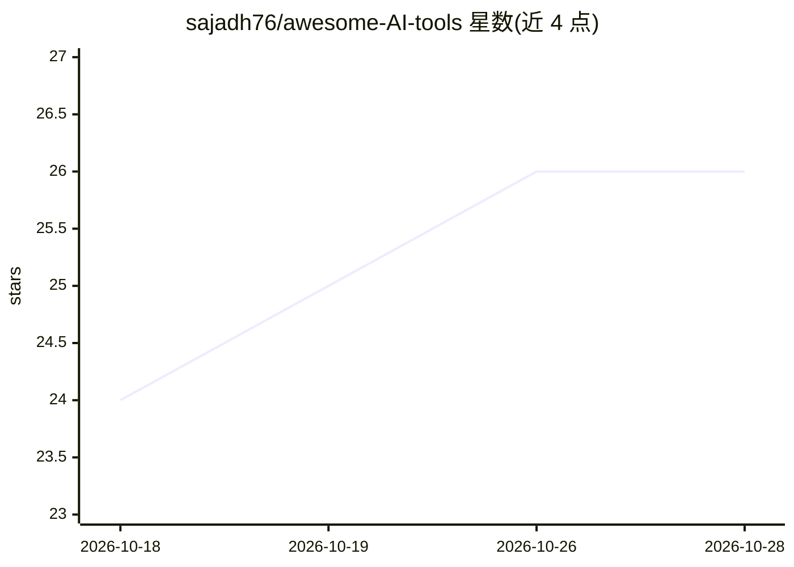

# sajadh76/awesome-AI-tools

⭐ 26 · MIT · 推送 2026-10-25 · [GitHub](https://github.com/sajadh76/awesome-AI-tools) · 个人维护 · 中文 README

**每周更新的 AI 工具策展清单，覆盖 100+ 工具**

个人维护的 awesome 类 AI 工具目录，按 Agentic AI、自动化、聊天摘要、网络安全、金融、图像生成、编程、研究引用等约 15 个类别组织条目；收录对象包括 AutoGPT、N8N、Midjourney、Cursor、GitHub Copilot、NotebookLM 等闭源产品与开源项目，开源条目以 🔓 标注并提供源码链接。README 声明每周更新并新增工具。列表本身不含代码，不提供安装或运行方式，仅供查找和比较工具之用。

## 筛选速览

| 维度 | 判定 | 备注 |
|---|---|---|
| AI 角色 | `ai-knowledge` | 知识聚合/清单类 |
| 许可风险 | `permissive` | MIT |
| 部署形态 | `None` |  |
| 模型依赖 | — | README 未给出锁定关系 |
| 硬件要求 | — | 无带数字的原话,不猜 |
| 安装摩擦 | `low` | 无编译、无系统依赖或容器化 |
| 成熟度 | — | 结构信号不足 |

## 能力要点

- 按约 15 个功能类别组织的 AI 工具条目目录
- 开源项目以 🔓 标注区分
- README 声明每周新增工具

## 适用场景

- 按类别浏览查找写作、编程、设计等场景的 AI 工具
- 发现开源可自部署的 AI 项目
- 跟踪新出现的 AI 工具条目

## 场景标签

`精选清单` · 领域:学习与行业

## 证据(README 行号)

> L5: > A curated list of AI-powered tools for writing, coding, research, design, video, voice, automation, and more.
> L7:  **Actively maintained, new AI tools added every week.**

## 星数曲线

2026-10-18 24 → 2026-10-28 26（+2）

---
*卡片 v1 · prompt 1.4 · 生成 2026-10-26 · 置信度 high · 依据 README sha `97aebf6f346b` · [字段定义](../../DATASET.md)*
