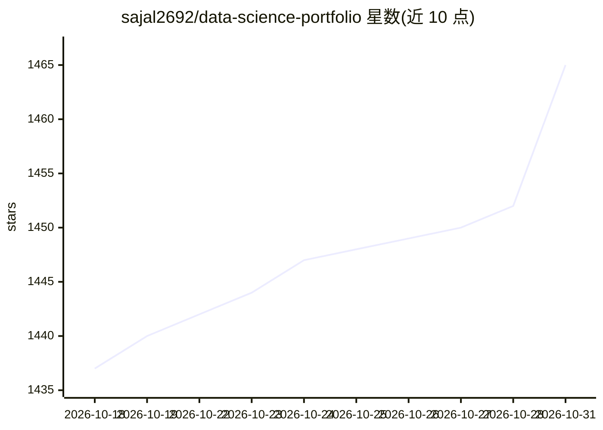

# sajal2692/data-science-portfolio

⭐ 1,465 · Jupyter Notebook · MIT · 推送 2026-07-07 · [GitHub](https://github.com/sajal2692/data-science-portfolio) · [官网](https://sajalsharma.com) · 个人维护

**个人数据科学项目作品集：Jupyter 笔记本与 R 分析集合**

作者 2016 年早期完成的数据科学项目合集，2026 年刷新为可在 Python 3.14 栈上从上到下运行的 Jupyter 笔记本，另含发布于 RPubs 的若干 R 分析。项目用 uv 做环境管理，也可用 pip 安装依赖；多数笔记本读取 data/ 目录下的小型演示数据，数字识别笔记通过 torchvision 下载 MNIST，股票分析笔记通过 yfinance 拉取科技股价格（带本地快照回退）。面向学习基础或搭建自己作品集的读者作参考。

## 筛选速览

| 维度 | 判定 | 备注 |
|---|---|---|
| AI 角色 | `ai-knowledge` | 知识聚合/清单类 |
| 许可风险 | `permissive` | MIT |
| 部署形态 | `library` | 以包/库形式分发 |
| 模型依赖 | — | README 未给出锁定关系 |
| 硬件要求 | — | 无带数字的原话,不猜 |
| 安装摩擦 | `low` | 无编译、无系统依赖或容器化 |
| 成熟度 | `idea` | |

## 能力要点

- 以 Jupyter 笔记本组织的多主题数据科学项目合集
- 2026 年刷新，可在当前 Python 3.14 栈上完整运行
- uv 环境管理与 pip 双安装路径
- MNIST/股票数据首次运行时下载并缓存

## 适用场景

- 数据科学入门者参考范例项目
- 搭建个人作品集时借鉴组织形式
- 查找 NLP、机器学习等主题的笔记本练习

## 场景标签

`教程课程` · 领域:学习与行业

## 证据(README 行号)

> L3: > These are data-science projects I built early in my career (around 2016). If you're starting out — learning the fu
> L5: A collection of data-science projects — completed for academic, self-learning, and hobby purposes — presented as Jup

## 星数曲线

2026-10-18 1,437 → 2026-10-31 1,465（+28）

---
*卡片 v1 · prompt 1.4 · 生成 2026-10-21 · 置信度 high · 依据 README sha `5da330bb73b0` · [字段定义](../../DATASET.md)*
