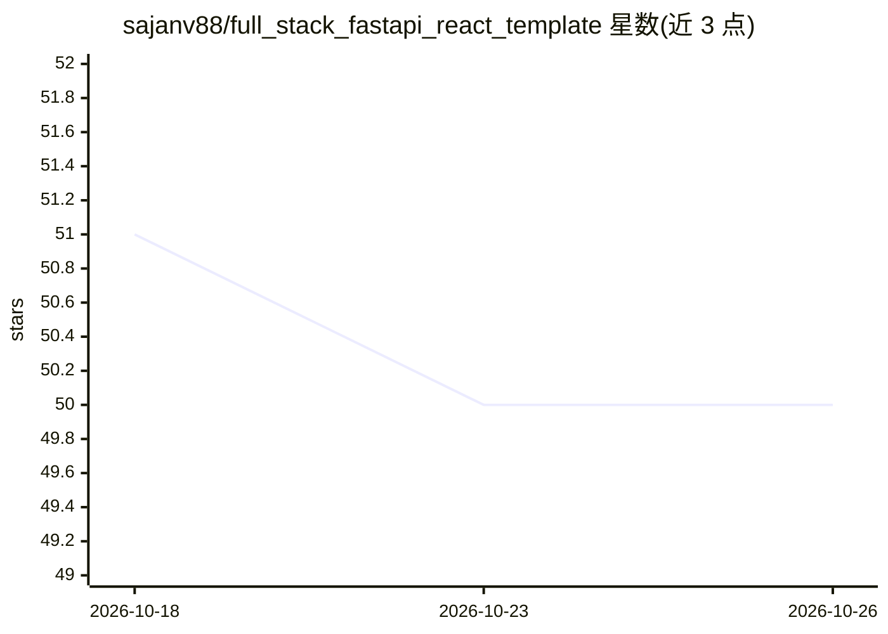

# sajanv88/full_stack_fastapi_react_template

⭐ 50 · TypeScript · MIT · 推送 2026-10-24 · [GitHub](https://github.com/sajanv88/full_stack_fastapi_react_template) · 个人维护

**多租户全栈 Web 应用模板：FastAPI+React，含 AI 聊天**

基于 Clean Architecture 的全栈多租户 SaaS 应用模板：FastAPI 后端（MongoDB/Beanie、Redis、Celery、JWT 认证、Passkey 与 Magic Link 登录）、React 18+TypeScript 前端，内置租户管理、RBAC 角色权限、Azure Blob/AWS S3 云存储抽象、Stripe 支付订阅、功能开关与子域名/自定义域名路由。其中 AI 部分：接入本地安装的 AI 模型，提供流式聊天界面、聊天历史与模型切换，后端用 LangChain 做集成。部署支持 Docker Compose、Helm 与 Coolify。要求 Python 3.13+、Node.js 22+。

## 筛选速览

| 维度 | 判定 | 备注 |
|---|---|---|
| AI 角色 | `ai-enhanced` | 去掉 AI 部分产品仍成立 |
| 许可风险 | `permissive` | MIT |
| 部署形态 | `self-host` | docker 或自建部署 |
| 模型依赖 | — | README 未给出锁定关系 |
| 硬件要求 | — | 无带数字的原话,不猜 |
| 安装摩擦 | `low` | 无编译、无系统依赖或容器化 |
| 成熟度 | — | 结构信号不足 |

## 能力要点

- 多租户数据隔离与子域名/自定义域名路由
- JWT/Passkey/Magic Link/SSO 认证与 RBAC 权限矩阵
- Azure Blob 与 AWS S3 存储抽象，可切换提供商
- 接入本地 AI 模型的流式聊天界面（LangChain 集成）
- Stripe 产品/计划/订阅/发票完整支付功能

## 适用场景

- 以此模板为起点搭建多租户 SaaS 产品
- 快速获得含认证、计费、租户管理的全栈脚手架
- 在自有应用中提供基于本地模型的 AI 聊天功能

## 场景标签

`聊天机器人` · 领域:对话与助手

## 证据(README 行号)

> L38: ### 🤖 AI Chat Interface
> L39: - **Local AI Models**: Integration with locally installed AI models
> L115: - **LangChain** - AI/ML integration capabilities

## 星数曲线

2026-10-18 51 → 2026-10-26 50（-1）

---
*卡片 v1 · prompt 1.4 · 生成 2026-10-24 · 置信度 high · 依据 README sha `e4b454057bda` · [字段定义](../../DATASET.md)*
