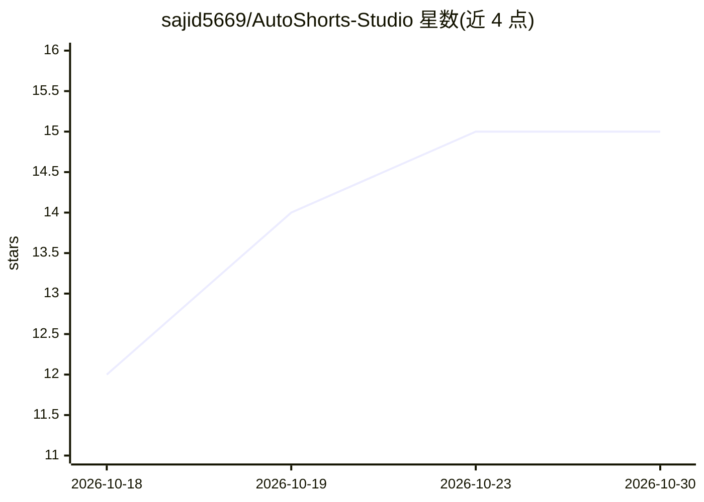

# sajid5669/AutoShorts-Studio

⭐ 15 · HTML · 推送 2026-10-29 · [GitHub](https://github.com/sajid5669/AutoShorts-Studio) · 个人维护

**面向社媒的自动化短视频生成平台（AI 脚本+配音+发布）**

容器化部署的短视频内容自动化平台：将热门话题、新闻或自定义提示词转化为成品视频，流程包括多 LLM 脚本生成（OpenAI/Anthropic，可回退本地 LLM）、Stable Diffusion/DALL-E 3 视觉生成、50+ 语音 30 语言的 TTS 配音、自动字幕与平台化排版，并发布到 YouTube/TikTok/Instagram/LinkedIn。面向内容创作者、营销团队和媒体机构。通过 Docker Compose 部署，需 8GB 以上内存与各 AI 服务 API key；许可证为 MIT。

## 筛选速览

| 维度 | 判定 | 备注 |
|---|---|---|
| AI 角色 | `ai-native` | 本体是模型或模型工具 |
| 许可风险 | `none` | — |
| 部署形态 | `self-host` | docker 或自建部署 |
| 模型依赖 | locked-api |  |
| 硬件要求 | — | 无带数字的原话,不猜 |
| 安装摩擦 | `low` | 无编译、无系统依赖或容器化 |
| 成熟度 | — | 结构信号不足 |

## 能力要点

- 多 LLM 脚本生成（OpenAI GPT-4 与 Claude，支持回退本地 LLM）
- Stable Diffusion / DALL-E 3 视觉生成与自动字幕
- 50+ 语音、30 语言的 TTS 配音管线
- 一键发布至 YouTube/TikTok/Instagram/LinkedIn

## 适用场景

- 把热门话题或提示词批量做成短视频内容
- 营销团队维持多平台持续的视频发布
- 多语言内容生产与本地化配音

## 场景标签

`视频生成` `语音合成` `图像生成` · 领域:内容生成

## 证据(README 行号)

> L7: AutoReel is an advanced, containerized platform that automates the creation of engaging short-form video content for
> L56: - **Multi-LLM Script Crafting**: Leverages both OpenAI GPT-4 and Anthropic Claude models for nuanced script develop
> L61: - **AI-Powered Imagery**: Generates custom visuals using Stable Diffusion and DALL-E 3 based on script context

## 星数曲线

2026-10-18 12 → 2026-10-30 15（+3）

---
*卡片 v1 · prompt 1.4 · 生成 2026-10-30 · 置信度 high · 依据 README sha `693d530901c3` · [字段定义](../../DATASET.md)*
