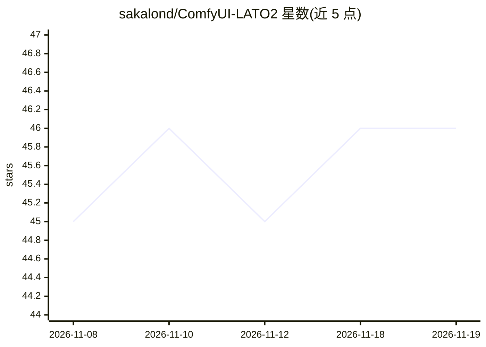

# sakalond/ComfyUI-LATO2

⭐ 46 · Python · GPL-3.0 · 推送 2026-11-03 · [GitHub](https://github.com/sakalond/ComfyUI-LATO2) · [官网](https://github.com/sakalond/ComfyUI-LATO2#readme) · 个人维护

**ComfyUI 节点：把稠密生成网格重拓扑为低多边形网格**

将 LATO.2 模型封装为 ComfyUI 自定义节点：读取 TRELLIS.2、Hunyuan3D 生成的稠密网格或扫描/3D 文件，通过顶点流与拓扑流生成 200–5000 顶点的低多边形网格。节点补充了工程处理：封闭曲面重建、体素泛填去除内壁、结果复位到输入位置与尺度，并为无 Windows 构建的 CUDA 扩展提供可移植替身（免编译）。纹理/UV 不保留，一次处理一个网格。需要 NVIDIA GPU（8GB VRAM），安装器单独构建 PyTorch 2.8 环境。

## 筛选速览

| 维度 | 判定 | 备注 |
|---|---|---|
| AI 角色 | `ai-native` | 本体是模型或模型工具 |
| 许可风险 | `viral` | GPL-3.0 |
| 部署形态 | `None` |  |
| 模型依赖 | — | README 未给出锁定关系 |
| 硬件要求 | — | 无带数字的原话,不猜 |
| 安装摩擦 | `medium` | 含编译或系统依赖之一 |
| 成熟度 | — | 结构信号不足 |

## 能力要点

- 顶点流+拓扑流生成 200–5000 顶点的低多边形网格，非简化器
- 曲面重建为单一封闭流形并统一朝外
- CUDA 扩展提供 NumPy/PyTorch 可移植替身，Windows/Linux 免编译
- 支持原生 MESH 类型与 .glb/.obj/.ply/.stl 输入，输出 GLB

## 适用场景

- 把 TRELLIS.2/Hunyuan3D 生成的稠密网格转成可用于游戏引擎的低模
- 在 ComfyUI 工作流中图像生成 3D 后直接做重拓扑
- 为道具、载具、角色生成艺术家风格的低多边形资产

## 场景标签

 · 领域:3D 生成/网格处理

## 证据(README 行号)

> L16: LATO.2 (paper) generates a new mesh for a given shape: a *vertex flow* places
> L34: - **Windows and Linux without compiling.** LATO.2 depends on CUDA extensions with no Windows builds; the node ships

## 星数曲线

2026-11-08 45 → 2026-11-19 46（+1）

---
*卡片 v1 · prompt 1.4 · 生成 2026-11-18 · 置信度 high · 依据 README sha `2d84e49543ad` · [字段定义](../../DATASET.md)*
