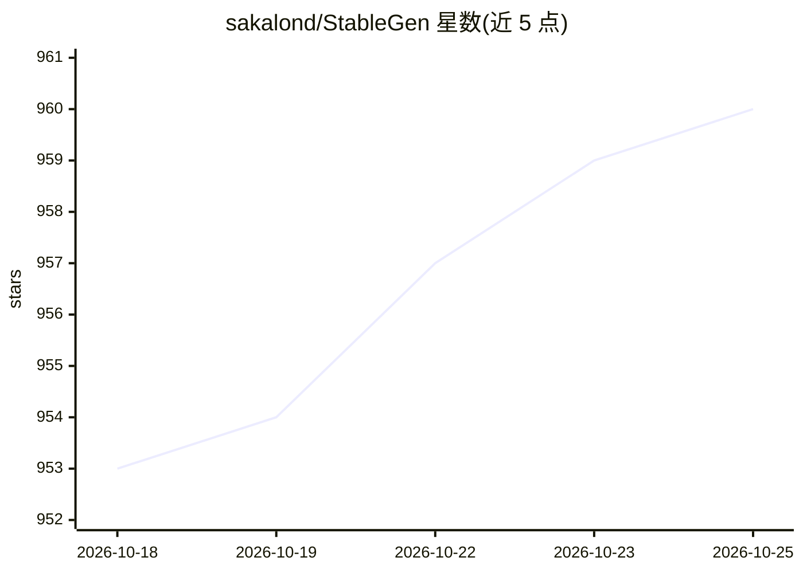

# sakalond/StableGen

⭐ 964 · Python · GPL-3.0 · 推送 2026-10-17 · [GitHub](https://github.com/sakalond/StableGen) · 个人维护

**Blender 生成式 AI 插件：图像/文本生成并纹理化 3D 模型**

面向 Blender 用户的开源插件（GPL v3）：通过 TRELLIS.2（4B 参数模型）从单张图像或文本提示生成带纹理的 3D 网格，再用 SDXL、FLUX.1-dev 或 Qwen Image Edit 做纹理与细化，重计算交由外部 ComfyUI 服务器执行。功能覆盖场景级多网格批量纹理、7 种相机布置策略、ControlNet/IPAdapter 引导、局部编辑与重绘、PBR 贴图生成，以及面向 3D 打印的多色 3MF/STL 导出与颜料混合求解。以 Blender 插件安装包形式分发。

## 筛选速览

| 维度 | 判定 | 备注 |
|---|---|---|
| AI 角色 | `ai-native` | 本体是模型或模型工具 |
| 许可风险 | `dual` | GPL-3.0 |
| 部署形态 | `desktop` | 安装包/桌面程序 |
| 模型依赖 | — | README 未给出锁定关系 |
| 硬件要求 | — | 无带数字的原话,不猜 |
| 安装摩擦 | `high` | 编译与系统依赖俱全 |
| 成熟度 | — | 结构信号不足 |

## 能力要点

- TRELLIS.2 单图/文本生成带纹理 3D 网格（512–1536 多档分辨率）
- 场景级多网格批量纹理，支持 SDXL/FLUX.1-dev/Qwen Image Edit
- ControlNet 多单元与 IPAdapter 风格引导
- 3D 打印多色导出（3MF/STL）与 Kubelka-Munk 颜料混合求解

## 适用场景

- 从参考图或文字提示快速生成可用的 3D 资产
- 为整个场景或资产库批量生成多视角一致的贴图
- 将生成的多色模型导出到切片软件进行多色 3D 打印

## 场景标签

`图像生成` · 领域:内容生成

## 证据(README 行号)

> L7: **Create 3D assets from images and prompts, then texture and refine them - all inside Blender.**
> L9: StableGen is an open-source Blender addon that brings generative AI into your 3D workflow. **Generate** fully textur
> L26:  * Powered by ComfyUI-TRELLIS2 (installable via `installer.py`).

## 星数曲线

2026-10-18 953 → 2026-10-25 960（+7）

---
*卡片 v1 · prompt 1.4 · 生成 2026-10-21 · 置信度 low · 依据 README sha `1649ef4cd22d` · [字段定义](../../DATASET.md)*
