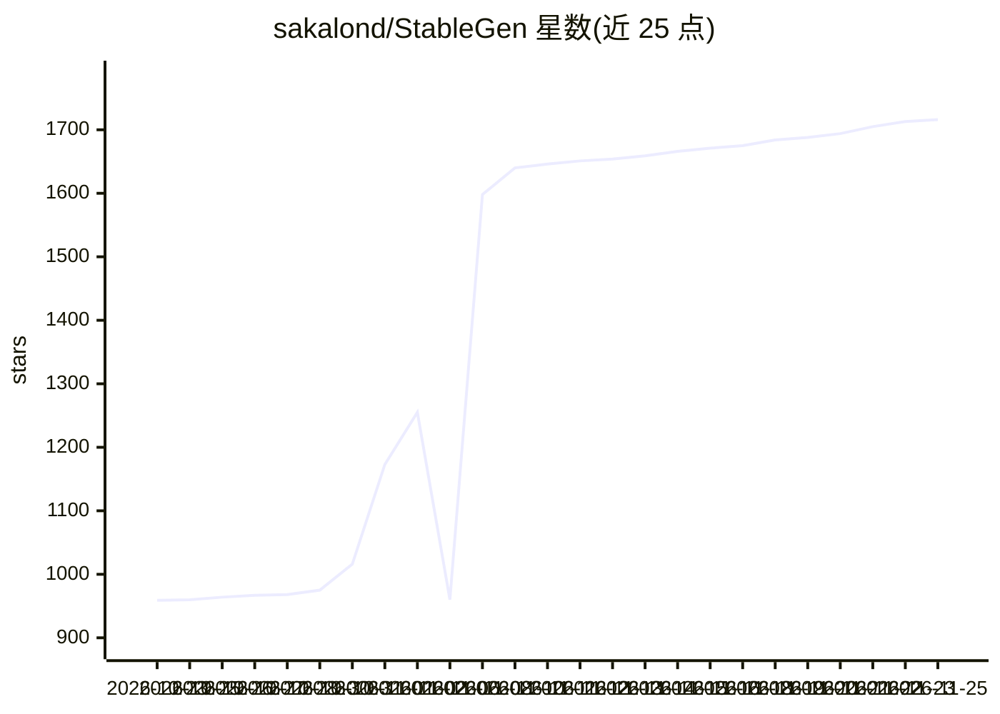

# sakalond/StableGen

⭐ 1,716 · Python · GPL-3.0 · 推送 2026-11-04 · [GitHub](https://github.com/sakalond/StableGen) · 个人维护

**Blender 插件：用扩散模型为 3D 网格生成纹理与新资产**

StableGen 是一个 Blender 扩展插件，在场景中放置相机渲染引导图，将生成任务发送到本机或网络中的 ComfyUI 服务器，再把结果投影回网格表面。功能覆盖多视角一致性纹理生成、蒙版局部编辑、Marigold 估算 PBR 贴图、TRELLIS.2 从提示词或图像生成网格、SkinTokens 自动绑定骨骼、LATO.2 低多边形重建，并支持烘焙后导出 glTF/FBX 至游戏引擎。要求 Blender 4.2–4.5 或 5.1+，模型文件占用 10–50 GB 磁盘，部分依赖模型仅限非商业使用。

## 筛选速览

| 维度 | 判定 | 备注 |
|---|---|---|
| AI 角色 | `ai-native` | 本体是模型或模型工具 |
| 许可风险 | `dual` | GPL-3.0 |
| 部署形态 | `None` |  |
| 模型依赖 | — | README 未给出锁定关系 |
| 硬件要求 | `gpu-8g` | |
| 安装摩擦 | `low` | 无编译、无系统依赖或容器化 |
| 成熟度 | — | 结构信号不足 |

## 能力要点

- 多相机视角生成并投影，保持纹理全局一致
- TRELLIS.2 从提示词/图像生成网格，SkinTokens 自动绑骨
- Marigold 估算并烘焙 albedo/roughness/metallic/normal PBR 贴图
- 烘焙导出 glTF（Godot/Web）与 FBX（Unreal/Unity）

## 适用场景

- 为 Blender 中的模型生成完整纹理
- 从提示词一键生成带骨骼绑定的角色资产
- 把生成的资产导入 Godot/Unreal/Unity 做游戏开发
- 对已有纹理做蒙版局部重绘修改

## 场景标签

`图像生成` · 领域:内容生成

## 证据(README 行号)

> L11: StableGen is a Blender add-on that textures meshes and whole scenes with diffusion models, and generates new meshes
> L61: StableGen runs inside Blender and sends the model work to a ComfyUI server, on the same computer or another one on 
> L147: StableGen is released under the GNU General Public License v3.0. The models and nodes it runs on ComfyUI have thei

## 星数曲线

2026-10-23 959 → 2026-11-25 1,716（+757）

---
*卡片 v1 · prompt 1.4 · 生成 2026-11-23 · 置信度 high · 依据 README sha `8f23dbbfe75b` · [字段定义](../../DATASET.md)*
