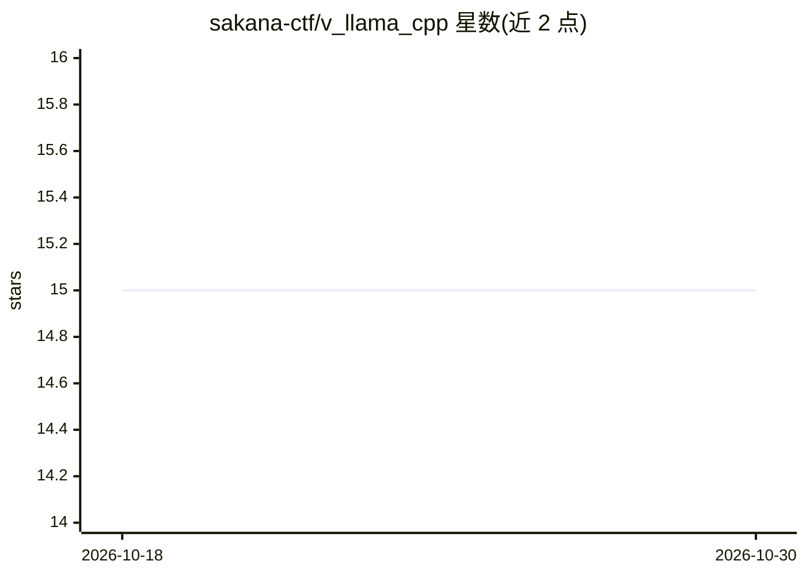

# sakana-ctf/v_llama_cpp

⭐ 15 · V · MIT · 推送 2026-06-17 · [GitHub](https://github.com/sakana-ctf/v_llama_cpp) · 个人维护 · 中文 README

**llama.cpp 的 V 语言绑定，供 V 项目本地运行 LLM**

用 V 语言封装 llama.cpp 的绑定库，使 V 项目可直接调用 llama.cpp 的本地推理能力，通过 C 互操作在 V 侧调用 llama.cpp API，在用户本机用 CPU/GPU 加载 GGUF 模型执行推理。安装方式为 git clone 后运行 v install.vsh，脚本会检测并尝试安装 llama.cpp 环境（可能需 root 权限）；若不存在 llama.cpp，可在 examples 中直接运行，模型文件自动从 Hugging Face 或 ModelScope 下载。提供卸载脚本与示例代码。

## 筛选速览

| 维度 | 判定 | 备注 |
|---|---|---|
| AI 角色 | `ai-ecosystem` | LLM/agent 周边工具 |
| 许可风险 | `permissive` | MIT |
| 部署形态 | `None` |  |
| 模型依赖 | local-ok | 支持本地模型 |
| 硬件要求 | — | 无带数字的原话,不猜 |
| 安装摩擦 | `low` | 无编译、无系统依赖或容器化 |
| 成熟度 | — | 结构信号不足 |

## 能力要点

- V 语言对 llama.cpp 的函数级封装
- v install.vsh 自动检测并安装 llama.cpp 环境
- 示例运行时自动下载 GGUF 模型文件
- 提供 atomgit/Gitee 国内克隆镜像

## 适用场景

- 在 V 语言项目中集成 llama.cpp 本地推理能力
- 通过 V 程序加载 GGUF 模型执行文本生成
- 无 GPU 环境下用纯 CPU 量化模型做推理

## 场景标签

`推理引擎` · 领域:训练与推理

## 证据(README 行号)

> L7: v_llama_cpp is the V language binding for llama.cpp, allowing you to directly use llama.cpp functionality in V langu
> L11: llama.cpp is an LLM (Large Language Model) inference framework implemented in C++, with the following main features

## 星数曲线

2026-10-18 15 → 2026-10-30 15（+0）

---
*卡片 v1 · prompt 1.4 · 生成 2026-10-30 · 置信度 high · 依据 README sha `a65b2dac27fd` · [字段定义](../../DATASET.md)*
