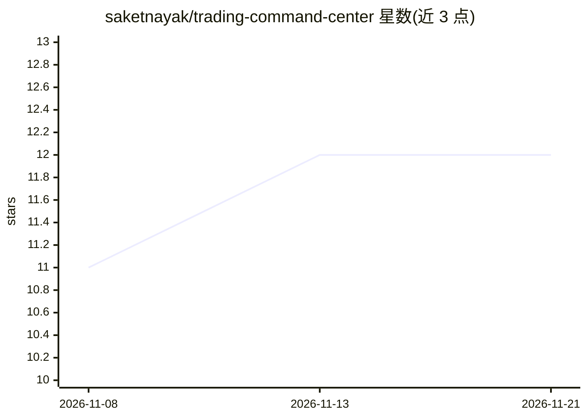

# saketnayak/trading-command-center

⭐ 12 · Python · MIT · 推送 2026-11-08 · [GitHub](https://github.com/saketnayak/trading-command-center) · 个人维护

**自托管 AI 投研团队 Web UI：多智能体分析持仓并生成简报**

自托管的股票与加密货币研究 Web 应用：从券商 CSV 导入持仓，运行多智能体 LLM 深度分析（分析师团队、多空研究员、风控），输出 BUY/SELL/HOLD 判定与理由；提供每日 AI 简报、自然语言告警规则、SEC 文件摘要、ETF 持仓透视、绩效/风险/再平衡分析、回测实验室与判定准确率追踪。仅研究用途，不执行真实交易；数据留在本机，使用用户自己的 API key。Docker 一键安装，支持 Windows/macOS/Linux。

## 筛选速览

| 维度 | 判定 | 备注 |
|---|---|---|
| AI 角色 | `ai-native` | 本体是模型或模型工具 |
| 许可风险 | `permissive` | MIT |
| 部署形态 | `self-host` | docker 或自建部署 |
| 模型依赖 | — | README 未给出锁定关系 |
| 硬件要求 | — | 无带数字的原话,不猜 |
| 安装摩擦 | `low` | 无编译、无系统依赖或容器化 |
| 成熟度 | — | 结构信号不足 |

## 能力要点

- 多智能体 LLM 分析：分析师、多空研究员与风控实时流式协作，输出带理由的 BUY/SELL/HOLD 判定
- 每日 AI 简报、自然语言告警规则引擎（15 分钟确定性检查，Slack/Telegram/邮件/webhook 投递）
- 绩效、风险（VaR/蒙特卡洛）、再平衡、税务批次与净资产追踪
- +7d/+14d/+30d/+90d 判定结果追踪与回测实验室

## 适用场景

- 把自己在各券商的持仓集中到一个面板并每日获得 AI 研究简报
- 对个股或加密货币标的做多智能体深度分析并回看历史准确率
- 用自然语言设定价格/均线/判定的组合告警

## 场景标签

`多智能体` `金融量化` · 领域:Agent 开发

## 证据(README 行号)

> L10: **Track your portfolio, get AI-powered research on every holding, and wake up every morning to an automated briefin
> L41: *Live agent analysis — watch the analyst team, bull/bear researchers, and risk desk work in real time.*
> L55: - **Run a deep multi-agent analysis** on any stock or crypto ticker in minutes

## 星数曲线

2026-11-08 11 → 2026-11-21 12（+1）

---
*卡片 v1 · prompt 1.4 · 生成 2026-11-18 · 置信度 mid · 依据 README sha `2b795e31bdaf` · [字段定义](../../DATASET.md)*
