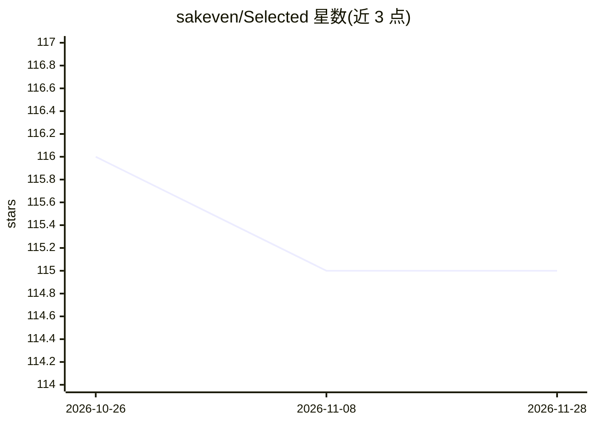

# sakeven/Selected

⭐ 115 · Swift · GPL-3.0 · 推送 2026-11-27 · [GitHub](https://github.com/sakeven/Selected) · [官网](https://plus.anynotes.app/) · 个人维护 · 中文 README

**macOS 菜单栏工具：对选中文本执行搜索/翻译/AI 动作**

运行于菜单栏的 macOS 应用，对其他应用中选中的文本提供搜索、翻译、复制、朗读、计算器、打开链接/地图、分享等动作，并支持 ⌥X 快速输入面板与剪贴板历史（默认关闭，可设保留期）。通过 .selectedext 插件扩展动作，内置可视化编辑器支持 URL、macOS Service、快捷键、AI Prompt、本地命令五类动作。AI 功能需自配 OpenAI 兼容 API key 与模型；搜索与复制无需 key。要求 macOS 15.0+，并需授予辅助功能与浏览器自动化权限。

## 筛选速览

| 维度 | 判定 | 备注 |
|---|---|---|
| AI 角色 | `ai-enhanced` | 去掉 AI 部分产品仍成立 |
| 许可风险 | `viral` | GPL-3.0 |
| 部署形态 | `desktop` | 安装包/桌面程序 |
| 模型依赖 | — | README 未给出锁定关系 |
| 硬件要求 | — | 无带数字的原话,不猜 |
| 安装摩擦 | `low` | 无编译、无系统依赖或容器化 |
| 成熟度 | — | 结构信号不足 |

## 能力要点

- 选中文本旁弹出动作工具栏，可按应用自定义动作列表
- 剪贴板历史支持搜索、预览、置顶、粘贴纯文本与 JSON 格式化
- .selectedext 插件体系与可视化编辑器（含 YAML 模式与测试功能）
- AI 配置支持自定义 API Host，翻译/朗读/摘要/改写等 AI 动作

## 适用场景

- 阅读外文资料时选中即翻译并附释义例句
- 将选中文本一键发送到自定义搜索引擎或本地脚本
- 整理剪贴板复制历史，回溯并复用之前复制的内容

## 场景标签

`AI 助手` · 领域:对话与助手

## 证据(README 行号)

> L3: A macOS menu bar app for working with selected text. Select a passage to search, translate, copy, read aloud, or run
> L19: 5. Select text in another app and click an action on the toolbar. Search and copy work without an AI key. To use tr
> L136: |AI Prompt|Summarize or rewrite text with a prompt such as `Summarize the following: {{selected.text}}`. Uses the 

## 星数曲线

2026-10-26 116 → 2026-11-28 115（-1）

---
*卡片 v1 · prompt 1.4 · 生成 2026-11-28 · 置信度 high · 依据 README sha `4e5c51f393b7` · [字段定义](../../DATASET.md)*
