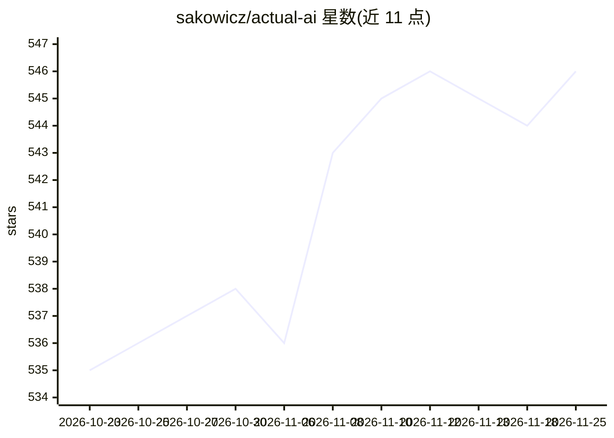

# sakowicz/actual-ai

⭐ 546 · TypeScript · MIT · 推送 2026-11-23 · [GitHub](https://github.com/sakowicz/actual-ai) · 个人维护

**为 Actual Budget 用 LLM 自动分类未归类交易的工具**

以 Docker 容器运行的辅助应用：读取 Actual Budget 中的未分类交易，将描述、金额、备注等字段填入可自定义的 Handlebars 提示模板发给 LLM，回写分类结果，并在备注中标记 guessed/not-guessed 以便复查。支持按 cron 定时运行、同步账户、为新交易建议并自动创建新类别、通过 ValueSerp 网络搜索补充陌生商户信息、dry run 预演模式与每分钟请求/token 限流覆盖。依赖 Actual 服务器实例；OpenID 登录需改用会话令牌。

## 筛选速览

| 维度 | 判定 | 备注 |
|---|---|---|
| AI 角色 | `ai-enhanced` | 去掉 AI 部分产品仍成立 |
| 许可风险 | `permissive` | MIT |
| 部署形态 | `None` |  |
| 模型依赖 | local-ok | 支持本地模型 |
| 硬件要求 | — | 无带数字的原话,不猜 |
| 安装摩擦 | `low` | 无编译、无系统依赖或容器化 |
| 成熟度 | — | 结构信号不足 |

## 能力要点

- 支持 OpenAI、Anthropic、Google Generative AI、Ollama 及兼容 API（OpenRouter/Requesty/UberLLM）作为后端
- PROMPT_TEMPLATE 环境变量配合 Handlebars 变量自定义分类提示词
- 可建议并自动创建新类别，未命中交易标记 #actual-ai-miss 并支持重跑
- cron 定时任务、dry run 模式与按部署覆盖的请求/token 限流

## 适用场景

- 自动归类 Actual Budget 里长期未处理的交易
- 让 LLM 为不符合现有类别的交易扩充预算类别
- 陌生商户较多时借助网络搜索辅助分类
- 先用 dry run 预览再实际写入分类结果

## 场景标签

 · 领域:个人财务/记账工具

## 证据(README 行号)

> L13: This is a project that allows you to categorize uncategorized transactions
> L15: using OpenAI, Anthropic, Google Generative AI, Ollama
> L22: The app sends requests to the LLM to classify transactions based on their description, amount, and notes.

## 星数曲线

2026-10-23 535 → 2026-11-25 546（+11）

---
*卡片 v1 · prompt 1.4 · 生成 2026-11-25 · 置信度 high · 依据 README sha `eed058c32bec` · [字段定义](../../DATASET.md)*
