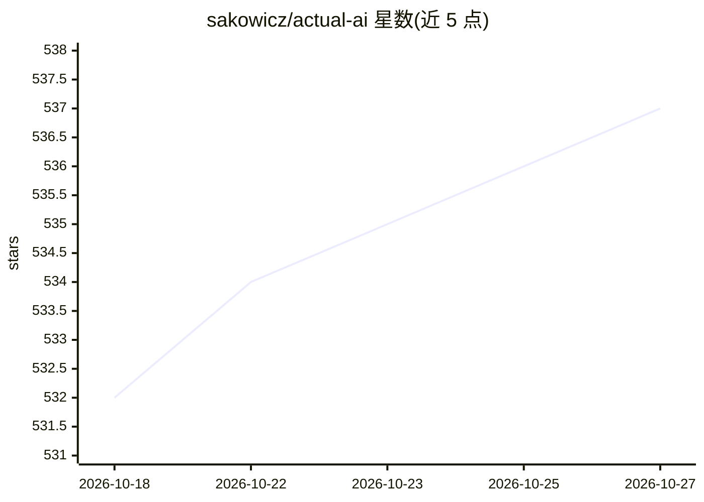

# sakowicz/actual-ai

⭐ 537 · TypeScript · MIT · 推送 2026-10-02 · [GitHub](https://github.com/sakowicz/actual-ai) · 个人维护

**用 LLM 自动分类 Actual Budget 记账交易的 Docker 服务**

面向 Actual Budget 用户的交易自动分类工具：通过 OpenAI、Anthropic、Google Generative AI、Ollama 或 OpenRouter 等兼容 API 调用 LLM，根据交易描述、金额、备注等给出分类；支持启动前同步账户、cron 定时分类、为无法分类的交易建议并创建新类目、经 ValueSerp 网络搜索陌生商户补充上下文。默认 dryRun 模式不改动数据，分类结果以 Notes 标记可人工复核；提供速率限制覆盖与 Handlebars 提示词模板自定义。以 Docker 镜像与 docker-compose 方式运行。

## 筛选速览

| 维度 | 判定 | 备注 |
|---|---|---|
| AI 角色 | `ai-native` | 本体是模型或模型工具 |
| 许可风险 | `permissive` | MIT |
| 部署形态 | `None` |  |
| 模型依赖 | local-ok | 支持本地模型 |
| 硬件要求 | — | 无带数字的原话,不猜 |
| 安装摩擦 | `low` | 无编译、无系统依赖或容器化 |
| 成熟度 | — | 结构信号不足 |

## 能力要点

- 多提供商接入：OpenAI/Anthropic/Google/Ollama/OpenRouter 等兼容 API
- cron 定时分类与启动前账户同步，每轮新进程运行
- suggestNewCategories 为无法分类的交易建议并创建新类目
- 默认 dryRun 模式，所有变更先记录到控制台

## 适用场景

- 自动分类 Actual Budget 中未分类的交易
- 让 LLM 为现有类目结构外的新交易建议新类目
- 按定时任务持续处理新增交易并复核结果

## 场景标签

 · 领域:个人财务/自动化工具

## 证据(README 行号)

> L13: This is a project that allows you to categorize uncategorized transactions
> L15: using OpenAI, Anthropic, Google Generative AI, Ollama
> L22: The app sends requests to the LLM to classify transactions based on their description, amount, and notes.

## 星数曲线

2026-10-18 532 → 2026-10-27 537（+5）

---
*卡片 v1 · prompt 1.4 · 生成 2026-10-21 · 置信度 high · 依据 README sha `e0e1e42e5e93` · [字段定义](../../DATASET.md)*
