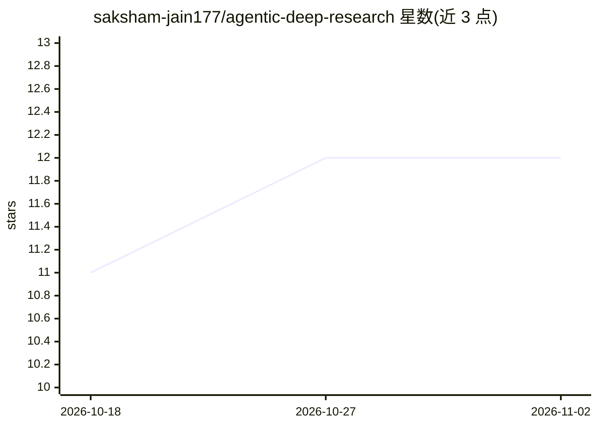

# saksham-jain177/agentic-deep-research

⭐ 12 · Python · MIT · 推送 2026-08-24 · [GitHub](https://github.com/saksham-jain177/agentic-deep-research) · [官网](https://deep-research-ai-agent.streamlit.app/) · 个人维护

**自动化网络调研并生成结构化报告的双 Agent 系统工具**

通过 Tavily API 并行搜索网络来源（默认排除社交平台，交叉编码器重排）、ChromaDB 向量缓存、证据表提炼与 LLM 起草，自动完成主题调研并生成可下载为 PDF/Word/Markdown/BibTeX 的结构化报告。报告含 LLM-as-a-Judge 验证摘要与冲突证据检测，失败章节仅局部重试。LLM 推理经 OpenRouter 接入，支持多级模型回退链。以 Streamlit 界面提供，需 Python 3.8+ 与 Tavily/OpenRouter API key，从源码运行。自动引用需人工核验，非事实核查引擎。

## 筛选速览

| 维度 | 判定 | 备注 |
|---|---|---|
| AI 角色 | `ai-native` | 本体是模型或模型工具 |
| 许可风险 | `permissive` | MIT |
| 部署形态 | `None` |  |
| 模型依赖 | locked-api |  |
| 硬件要求 | — | 无带数字的原话,不猜 |
| 安装摩擦 | `low` | 无编译、无系统依赖或容器化 |
| 成熟度 | — | 结构信号不足 |

## 能力要点

- Tavily 并行变体搜索 + 交叉编码器重排与领域过滤
- 证据表支撑分节起草与内联 [n] 引用校验
- LLM-as-a-Judge 验证摘要与冲突证据分级披露
- 章节级失败重试与 OpenRouter 模型回退链

## 适用场景

- 输入任意主题自动调研并生成带引用的研究报告
- 按学术/商务/技术等风格定制报告输出
- 对比多来源信息并获知冲突证据

## 场景标签

`科研工具` · 领域:学习与行业

## 证据(README 行号)

> L3: Generate comprehensive research reports on any topic using AI-powered web search and synthesis.
> L21: 4. **Synthesize** — LLM drafts structured reports in your chosen style; only failed sections are retried, not the w
> L72: |`OPENROUTER_API_KEY`|openrouter.ai|LLM inference|

## 星数曲线

2026-10-18 11 → 2026-11-02 12（+1）

---
*卡片 v1 · prompt 1.4 · 生成 2026-11-01 · 置信度 high · 依据 README sha `f93fcf3b24ca` · [字段定义](../../DATASET.md)*
