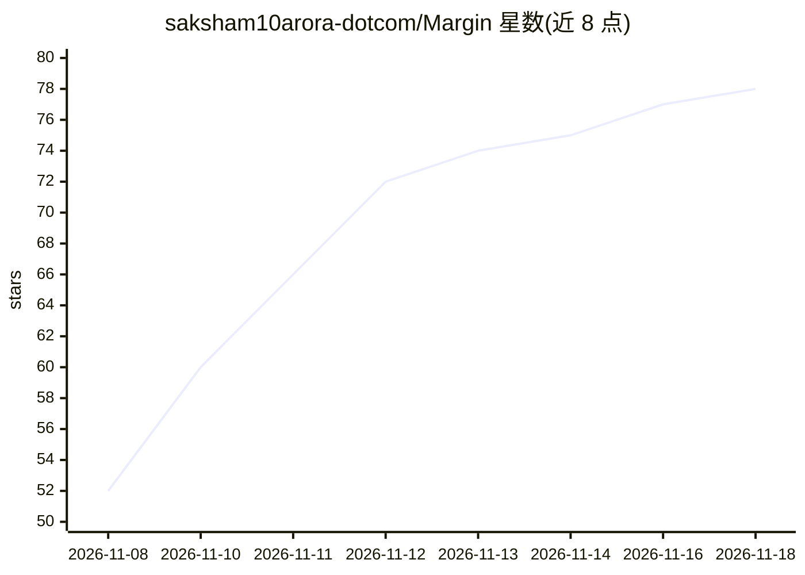

# saksham10arora-dotcom/Margin

⭐ 78 · Python · Apache-2.0 · 推送 2026-11-04 · [GitHub](https://github.com/saksham10arora-dotcom/Margin) · [官网](https://saksham.digital/margin) · 个人维护

**看视频课自动生成 Obsidian 学习笔记的 Chrome 扩展**

面向观看 Udemy、Coursera、DeepLearning.AI、YouTube 等视频课程的学习者的 Chrome 扩展加本地 sidecar 服务：边看课边捕获幻灯片、字幕或音频（本地 Whisper 转写），课程结束后由用户自选的模型按顺序写入 Obsidian 笔记，含直觉解释、KaTeX 公式、Mermaid 图、自测题、课程代码（在新内核中运行）、要点提炼（80/20）与闪卡，并可从课程内容回答提问、链接到视频对应时刻。支持免费 Gemini key、已有订阅（Claude/ChatGPT 等）、200+ API 提供商或本地模型（Ollama 等）。macOS 优先，Linux 用 start.sh 运行；需 Chrome 与 Python 3.11+。

## 筛选速览

| 维度 | 判定 | 备注 |
|---|---|---|
| AI 角色 | `ai-native` | 本体是模型或模型工具 |
| 许可风险 | `permissive` | Apache-2.0 |
| 部署形态 | `desktop` | 安装包/桌面程序 |
| 模型依赖 | local-ok | 支持本地模型 |
| 硬件要求 | — | 无带数字的原话,不猜 |
| 安装摩擦 | `medium` | 含编译或系统依赖之一 |
| 成熟度 | — | 结构信号不足 |

## 能力要点

- 自动捕获课程幻灯片并随笔记组织，代码在新内核中执行后保存
- 多模型按序回退：免费 Gemini key、已有订阅、200+ API 提供商或本地模型（Ollama/LM Studio/llama.cpp/vLLM 等）
- 生成要点提炼（80/20）、闪卡（可导出 Anki）与基于课程内容的问答（链接视频时刻）
- 捕获数据保留在本机，音频本地转写，密钥仅存于 ~/.margin/keys.env

## 适用场景

- 看 Udemy/Coursera/YouTube 课程时自动整理成结构化 Obsidian 笔记
- 课后用闪卡自测并导出到 Anki 做间隔重复
- 就课程内容提问并跳转到讲解的视频时刻
- 不想把课程数据送云端的用户配本地模型使用

## 场景标签

`知识库管理` · 领域:知识与检索

## 证据(README 行号)

> L3: **Watch a lecture. Get the notes.** Margin sits beside the video on Udemy, Coursera,
> L5: building, follows what is said, and when the lecture ends writes a study note
> L67: - **Any model you have.** A free Gemini key, a subscription you already pay for

## 星数曲线

2026-11-08 52 → 2026-11-18 78（+26）

---
*卡片 v1 · prompt 1.4 · 生成 2026-11-18 · 置信度 mid · 依据 README sha `278ffd604e89` · [字段定义](../../DATASET.md)*
