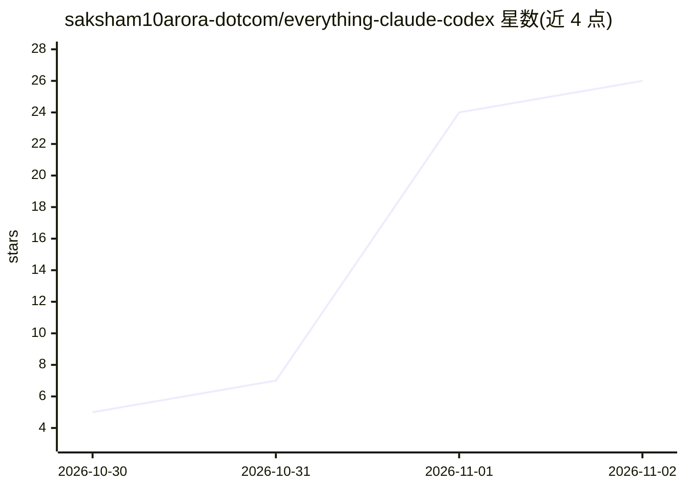

# saksham10arora-dotcom/everything-claude-codex

⭐ 26 · Python · MIT · 推送 2026-10-31 · [GitHub](https://github.com/saksham10arora-dotcom/everything-claude-codex) · 个人维护

**面向 Claude Code 与 Codex 的完整 AI 开发环境配置套件**

为 Claude Code 和 OpenAI Codex 两个 CLI agent 提供的配置集合：17 个技能（/boot、/daily、/ship 等）、21 个 hooks（会话启动记忆加载、完成前跑测试、危险命令拦截、MCP 健康检查）、3 种笔记库检索方式（ChromaDB 语义、LightRAG 图、CLIP 图像）、agent-sync 让两个 agent 共享记忆与消息，以及通过私有 GitHub 仓库实现笔记本关机后从手机继续的机制。以 git clone 加 install.sh 安装，要求 Python 3.9+，在 macOS 和 Linux 上测试。

## 筛选速览

| 维度 | 判定 | 备注 |
|---|---|---|
| AI 角色 | `ai-ecosystem` | LLM/agent 周边工具 |
| 许可风险 | `permissive` | MIT |
| 部署形态 | `None` |  |
| 模型依赖 | local-ok | 支持本地模型 |
| 硬件要求 | — | 无带数字的原话,不猜 |
| 安装摩擦 | `low` | 无编译、无系统依赖或容器化 |
| 成熟度 | — | 结构信号不足 |

## 能力要点

- Claude Code 与 Codex 共享同一记忆（含语音转录）的 agent-sync
- 21 个 hooks：测试先行、危险命令拦截、会话启动健康检查
- 语义/关系图/图像三种方式的笔记库检索，每夜重建索引
- 私有 GitHub 仓库作桥梁的手机访问模式，无需服务器

## 适用场景

- 让 Claude Code 和 Codex 在每次会话开始时读取我的记忆与上下文
- 阻止 agent 在测试未通过时声称完成，拦截危险命令
- 用自然语言检索我的笔记、幻灯片和截图
- 笔记本合盖后从手机继续与 agent 协作

## 场景标签

`Agent 记忆` `知识库管理` `RAG` · 领域:Agent 开发

## 证据(README 行号)

> L16: **The complete AI dev setup for Claude Code and Codex.** Your agents start every session already knowing you, share
> L27: |Hooks|**21**|Memory loading, tests before "done", a health check at every session start, a working danger guard, M
> L37: git clone https://github.com/saksham10arora-dotcom/everything-claude-codex ~/ecx

## 星数曲线

2026-10-30 5 → 2026-11-02 26（+21）

---
*卡片 v1 · prompt 1.4 · 生成 2026-11-01 · 置信度 high · 依据 README sha `0b8d318b124d` · [字段定义](../../DATASET.md)*
