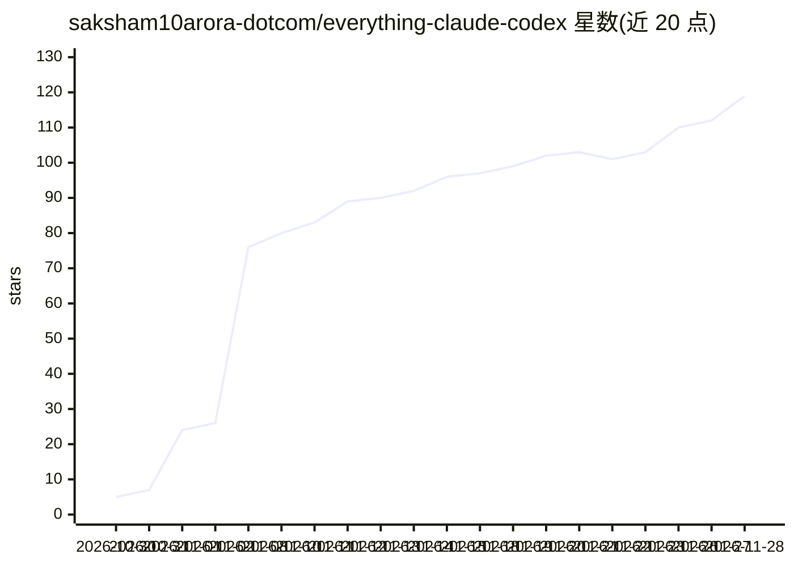

# saksham10arora-dotcom/everything-claude-codex

⭐ 119 · Python · MIT · 推送 2026-11-27 · [GitHub](https://github.com/saksham10arora-dotcom/everything-claude-codex) · 个人维护

**让 Claude Code 与 Codex 共享记忆与消息的本地协作配置集**

ECX 是一套围绕 Claude Code 与 Codex 的本地配置与钩子集合：两个 agent 通过同一组记忆文件（hot.md/AGENTS.md）与 agent-sync 钩子互见对方最新消息，共享语音口述的口令信息；配套 19 个 skills、21 个 hooks、基于 ChromaDB/LightRAG/CLIP 的三种 vault 检索、16+ 项 doctor 健康检查、危险命令防护，以及 duo 双 agent 协作模式。安装脚本从源码克隆运行，支持 macOS 与 Linux，手机端经由私有 GitHub 仓库桥接。声明非 skills 包，与 Superpowers 等包并行运行。

## 筛选速览

| 维度 | 判定 | 备注 |
|---|---|---|
| AI 角色 | `ai-ecosystem` | LLM/agent 周边工具 |
| 许可风险 | `permissive` | MIT |
| 部署形态 | `None` |  |
| 模型依赖 | locked-api |  |
| 硬件要求 | — | 无带数字的原话,不猜 |
| 安装摩擦 | `low` | 无编译、无系统依赖或容器化 |
| 成熟度 | — | 结构信号不足 |

## 能力要点

- Claude Code 与 Codex 读写同一记忆文件并互见最新消息（agent-sync，单文件 stdlib 实现）
- 三种检索：ChromaDB 语义、LightRAG 关系图、CLIP 图像搜索，夜间重建索引
- 16+ 项 doctor 自检、测试通过前禁止收尾、危险命令与 AI 措辞防护
- duo 模式让两个 agent 同分支协作，高风险操作以卡片等待用户批准

## 适用场景

- 在 Claude Code 与 Codex 之间接力任务而无需重复交代背景
- 手机上向笔记库口述想法，回笔记本后自动归档
- 让两个 agent 共同修复一个失败的测试并观看过程
- 会话启动前自动检查依赖工具是否可用并给出修复提示

## 场景标签

`Agent 记忆` `编码 Agent` `知识库管理` `RAG` · 领域:Agent 开发

## 证据(README 行号)

> L16: **Claude Code and Codex, working as one team.** Two agents from two different labs share one memory and see each ot
> L29: |Hooks|**21**|Memory loading, tests before "done", a health check at every session start, a working danger guard, M

## 星数曲线

2026-10-30 5 → 2026-11-28 119（+114）

---
*卡片 v1 · prompt 1.4 · 生成 2026-11-28 · 置信度 high · 依据 README sha `7c3d3053e01f` · [字段定义](../../DATASET.md)*
