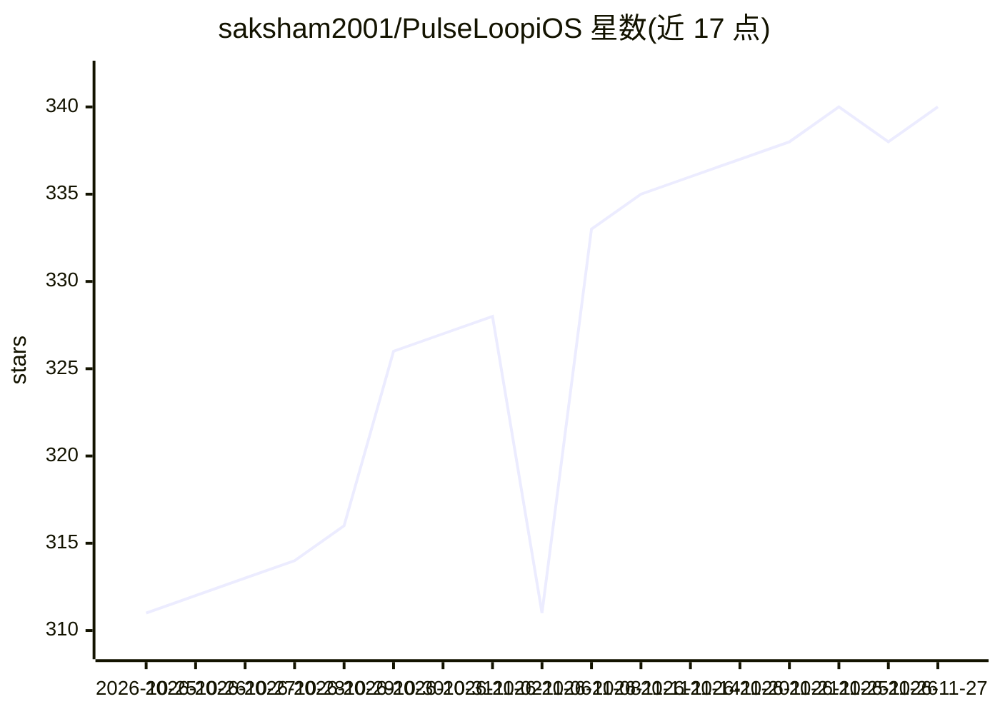

# saksham2001/PulseLoopiOS

⭐ 340 · Swift · CC-BY-4.0 · 推送 2026-11-16 · [GitHub](https://github.com/saksham2001/PulseLoopiOS) · 个人维护

**平价智能指环的 iOS 健康追踪器，可选拒绝付费墙的 AI 教练**

原生 iOS 健康追踪应用，通过蓝牙 LE 直连指环、解码私有协议（心率、血氧、步数、睡眠分期等），不依赖厂商云与账号，数据经 SwiftData 本地持久化。提供 Today/Vitals/Sleep/Activity 仪表盘、锻炼记录、营养追踪、Apple Health 导出与 Strava 上传。可叠加 AI 教练：基于用户数据的 agent 循环，读取指标、自主分析、绘图、长期记忆，支持 OpenAI/Gemini/OpenRouter/MiniMax/苹果端侧模型及自托管 OpenAI 兼容服务器。支持 8 个驱动家族的指环；CC BY 4.0 许可。

## 筛选速览

| 维度 | 判定 | 备注 |
|---|---|---|
| AI 角色 | `ai-enhanced` | 去掉 AI 部分产品仍成立 |
| 许可风险 | `viral` | CC-BY-4.0 |
| 部署形态 | `None` |  |
| 模型依赖 | local-ok | 支持本地模型 |
| 硬件要求 | — | 无带数字的原话,不猜 |
| 安装摩擦 | `low` | 无编译、无系统依赖或容器化 |
| 成熟度 | — | 结构信号不足 |

## 能力要点

- BLE 直连指环解码私有协议，无厂商云、无账号
- 可选拟人 AI 教练：数据分析、绘图、长期记忆与工具调用
- 8 个驱动家族支持多型号平价指环，含能力检测
- Apple Health 导出、Strava 上传、GPS 路线与灵动岛组件

## 适用场景

- 用平价指环本地追踪睡眠、心率与活动数据
- 通过 AI 教练提问个人睡眠与恢复情况
- 自托管本地 LLM 服务器做隐私优先的 AI 分析
- 将指环数据导出到 Apple Health 或 Strava

## 场景标签

`数据分析` · 领域:效率与自动化

## 证据(README 行号)

> L31: PulseLoop is a native iOS health tracker for affordable Bluetooth smart rings,
> L63: - **AI Coach** — an agentic loop (OpenAI, Google Gemini, OpenRouter, MiniMax,
> L145: **Not supported:** Oura, Ultrahuman, RingConn, and the SIMSONLAB **LA380-YJ**.

## 星数曲线

2026-10-25 311 → 2026-11-27 340（+29）

---
*卡片 v1 · prompt 1.4 · 生成 2026-11-25 · 置信度 high · 依据 README sha `2d28471a2c44` · [字段定义](../../DATASET.md)*
