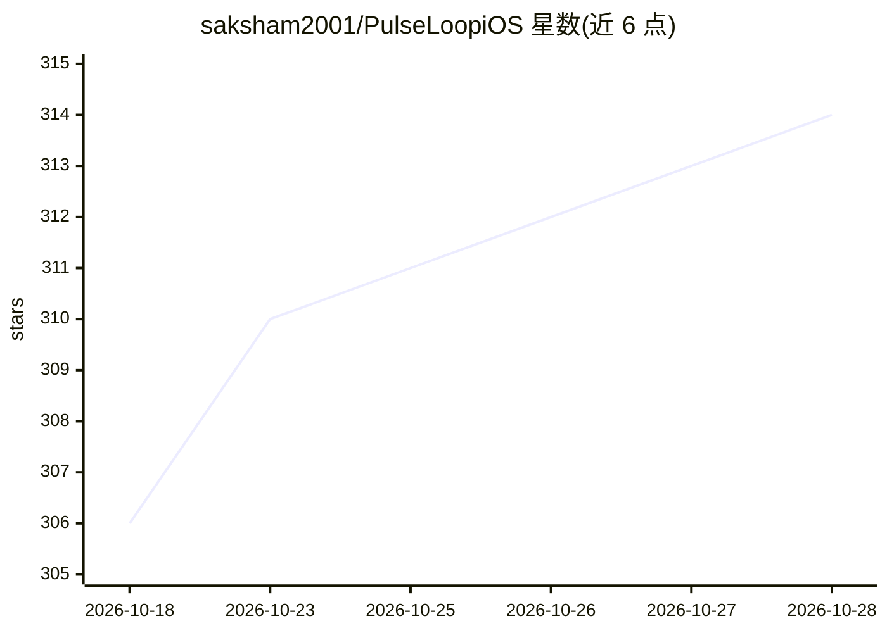

# saksham2001/PulseLoopiOS

⭐ 316 · Swift · CC-BY-4.0 · 推送 2026-10-15 · [GitHub](https://github.com/saksham2001/PulseLoopiOS) · 个人维护

**iOS 健康追踪应用：连接廉价智能戒指并内置可选 AI 教练**

SwiftUI 编写的 iOS 应用，通过蓝牙 LE 直连廉价智能戒指（generic Jring、Colmi/Yawell 家族、R10M、TK5），解码厂商私有协议读取心率、血氧、步数、睡眠分期等数据，本地 SwiftData 持久化，不依赖厂商云与账号。在此之上提供可选的 AI Coach 代理循环，支持 OpenAI、Gemini、OpenRouter、MiniMax、Apple 端侧模型及任意 OpenAI 兼容服务器（Ollama/llama.cpp/vLLM 等），可读取指标、生成图表、长期记忆并支持图片输入。另有 Android 姊妹项目共享 BLE 协议工作。安装途径为 TestFlight 公测或 Xcode 16+ 源码构建（需 iOS 18+ 设备）。TK5 戒指标注为实验性有限支持。

## 筛选速览

| 维度 | 判定 | 备注 |
|---|---|---|
| AI 角色 | `ai-enhanced` | 去掉 AI 部分产品仍成立 |
| 许可风险 | `viral` | CC-BY-4.0 |
| 部署形态 | `None` |  |
| 模型依赖 | local-ok | 支持本地模型 |
| 硬件要求 | — | 无带数字的原话,不猜 |
| 安装摩擦 | `low` | 无编译、无系统依赖或容器化 |
| 成熟度 | `idea` | |

## 能力要点

- BLE 直连智能戒指，解码私有协议，无需厂商云与账号
- 可选 AI Coach：多提供商/自托管 OpenAI 兼容服务器，带工具、图表生成、长期记忆与图片输入
- SwiftUI 原生界面 + SwiftData 本地持久化，含运动记录、GPS 路线与实时心率区间
- 设备无关驱动层，Colmi 戒指两种 BLE 协议均支持

## 适用场景

- 用廉价智能戒指记录睡眠、心率、活动并本地查看
- 向 AI 教练提问自己的健康趋势，让其分析数据生成图表
- 拍照食物/标签让教练结合自身数据分析

## 场景标签

`数据分析` · 领域:效率与自动化

## 证据(README 行号)

> L31: An LLM-native health app for iOS that turns a cheap Bluetooth "smart ring"
> L37: account) and layers an **optional** AI Coach on top of your own data. Instead of

## 星数曲线

2026-10-18 306 → 2026-10-28 314（+8）

---
*卡片 v1 · prompt 1.4 · 生成 2026-10-22 · 置信度 high · 依据 README sha `f799e9f75091` · [字段定义](../../DATASET.md)*
