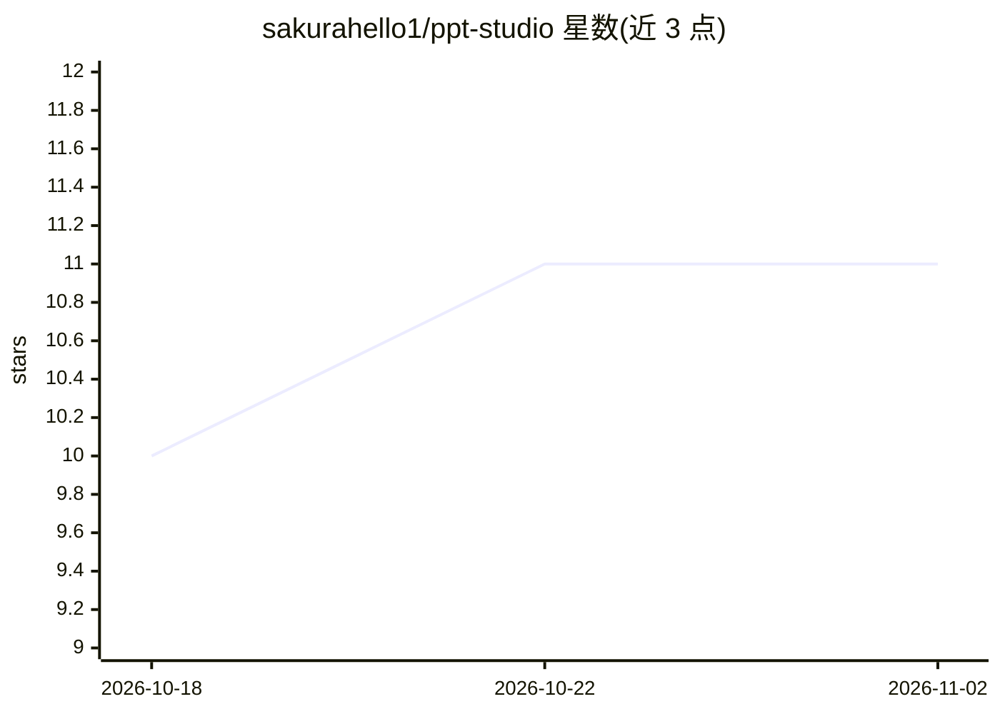

# sakurahello1/ppt-studio

⭐ 11 · Python · MIT · 推送 2026-09-22 · [GitHub](https://github.com/sakurahello1/ppt-studio) · [官网](https://zuoppt.top) · 个人维护 · 中文 README

**自部署网页应用：一句话生成整套 PPT，并可将图片型 PPT 重建成可编辑 pptx**

跑在本机的 Web 应用：用户用中文描述需求并可上传 Word/PDF/Excel/图片/PPT，agent 先确认风格与逐页大纲（均不花钱），再由图像模型逐页整图渲染，导出 .pptx；另提供图转可编辑管线（去字、分割、字体求解、重建），Windows 走 PowerPoint COM、Linux/macOS 走 LibreOffice headless。模型需自备 OpenAI 兼容接口（对话模型需工具调用，图像模型为主要成本），FAKE_IMAGE=1 可零成本走通全流程。含注册门禁、积分计费与管理面板，MIT 许可。

## 筛选速览

| 维度 | 判定 | 备注 |
|---|---|---|
| AI 角色 | `ai-native` | 本体是模型或模型工具 |
| 许可风险 | `permissive` | MIT |
| 部署形态 | `self-host` | docker 或自建部署 |
| 模型依赖 | — | README 未给出锁定关系 |
| 硬件要求 | — | 无带数字的原话,不猜 |
| 安装摩擦 | `low` | 无编译、无系统依赖或容器化 |
| 成熟度 | — | 结构信号不足 |

## 能力要点

- 一句话→风格确认→大纲确认→逐页整图渲染→自动质检→导出 pptx
- 图片型 PPT 反向重建为可编辑 pptx（去字/分割/抠图/字体求解/校准）
- 多个 OpenAI 兼容端点并存，图像主/备通道自动切换与冷却
- Windows 双击 start.bat / Linux·macOS start.sh / Docker compose 均可运行

## 适用场景

- 我说一句话、丢一堆资料，让 AI 画出整套可放映的 PPT
- 把只有图片的 PPT 拆成文字、图标和背景，重建为能改字的 pptx
- 在自己机器上部署一个可开放给多人使用、带积分计费的 PPT 生成站

## 场景标签

`图像生成` `文档解析` · 领域:内容生成

## 证据(README 行号)

> L16: **PPT Studio** is a self-hosted web app that turns one sentence (plus any material you drop in — Word, PDF, Excel, 
> L39: |**一句话生成整套 PPT**|需求 + 资料 → 风格方案（人审）→ 逐页大纲（人审、可逐字段手改）→ 逐页整图渲染 → 自动质检 → 导出 pptx|

## 星数曲线

2026-10-18 10 → 2026-11-02 11（+1）

---
*卡片 v1 · prompt 1.4 · 生成 2026-11-01 · 置信度 mid · 依据 README sha `96127e643db2` · [字段定义](../../DATASET.md)*
