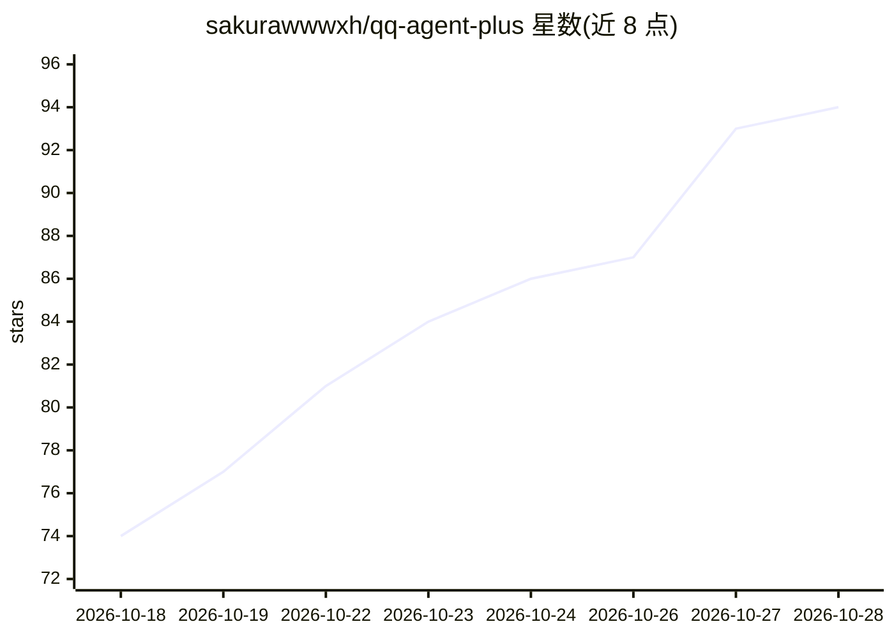

# sakurawwwxh/qq-agent-plus

⭐ 93 · JavaScript · MIT · 推送 2026-10-28 · [GitHub](https://github.com/sakurawwwxh/qq-agent-plus) · 个人维护 · 中文 README

**面向 Linux 服务器的 QQ 群聊 Agent，带贴纸/语音/主动发言与运维命令**

基于 Node.js 的自托管 QQ 群聊机器人，通过 OneBot v11 正向 WebSocket 连接外部协议端（如 SnowLuma），每次触发使用独立的 OpenAI Chat Completions 会话。功能覆盖单轮分条发言、QQ 表情包收发与自动收藏、群友长期记忆、轻量与状态机多人游戏、持久化提醒、主动发言三条链路、语音转写与合成（支持本机 whisper.cpp）、图片生成、插件子系统（独立子进程）及网页控制台与一键安装脚本。SQLite/WAL 存储消息状态机，发送结果无法确认时进入 held 待人工核对。需 Linux + systemd 环境。

## 筛选速览

| 维度 | 判定 | 备注 |
|---|---|---|
| AI 角色 | `ai-native` | 本体是模型或模型工具 |
| 许可风险 | `permissive` | MIT |
| 部署形态 | `self-host` | docker 或自建部署 |
| 模型依赖 | — | README 未给出锁定关系 |
| 硬件要求 | — | 无带数字的原话,不猜 |
| 安装摩擦 | `low` | 无编译、无系统依赖或容器化 |
| 成熟度 | — | 结构信号不足 |

## 能力要点

- 连接 OneBot v11 协议端，独立 Chat Completions 会话，消息仅处理成功后确认
- 语音转写支持零 Key 本机 whisper.cpp，视频抽帧交视觉模型
- 插件跑在独立子进程，manifest 声明式能力授权
- 一键安装脚本自动装 Docker、协议端与凭据，进程自动降权非 root

## 适用场景

- 在 Linux 服务器上自托管一个能分条发言、发表情包的 QQ 群聊机器人
- 让机器人主持多人游戏、管理持久化提醒与主动发言
- 通过网页控制台配置模型 API、响应概率与插件

## 场景标签

`聊天机器人` `Agent 记忆` `语音识别` `语音合成` · 领域:Agent 开发

## 证据(README 行号)

> L20: QQ Agent Plus 是面向 Linux 服务器的 QQ 群聊 Agent。它连接外部 OneBot v11 协议端，每次触发使用
> L21: 独立的 OpenAI Chat Completions 会话，不依赖 DSH、MCP、Electron 或 Windows 运行环境。

## 星数曲线

2026-10-18 74 → 2026-10-28 94（+20）

---
*卡片 v1 · prompt 1.4 · 生成 2026-10-24 · 置信度 mid · 依据 README sha `1372a35eac78` · [字段定义](../../DATASET.md)*
