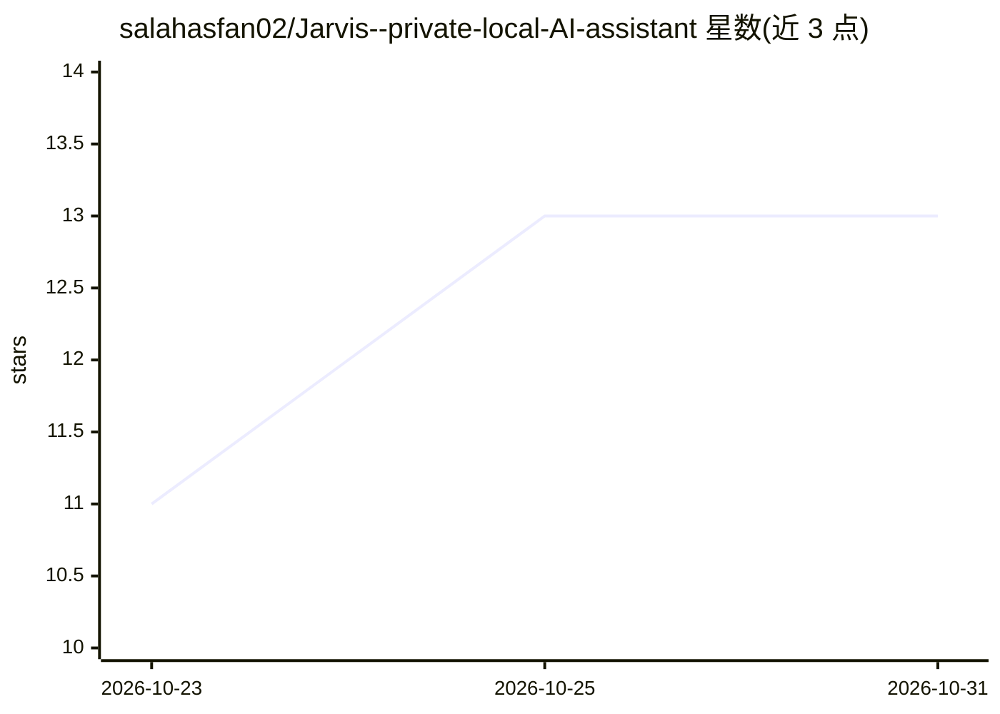

# salahasfan02/Jarvis--private-local-AI-assistant

⭐ 13 · Python · NOASSERTION · 推送 2026-10-18 · [GitHub](https://github.com/salahasfan02/Jarvis--private-local-AI-assistant) · [官网](https://buymeacoffee.com/salahasfan) · 个人维护

**macOS 本地 AI 助手：语音、视觉与自动化，全部本地运行**

面向 Mac 用户的本地 AI 助手应用：通过 Ollama 跑本地 LLM，支持唤醒词 + 离线 Whisper 语音识别、Kokoro TTS 语音回复、Apple Vision OCR 读屏、摄像头视觉、浏览器/App 自动化、智能灯控制、日程邮件 FaceTime 操作，以及文档 RAG、联网研究（带编号引用）与可组合的 agent/团队画布。所有数据不上传，无 API key。安装为 git clone 后运行 start.sh 自动装依赖，浏览器访问 localhost:5173；许可为非商用。

## 筛选速览

| 维度 | 判定 | 备注 |
|---|---|---|
| AI 角色 | `ai-native` | 本体是模型或模型工具 |
| 许可风险 | `none` | NOASSERTION |
| 部署形态 | `library` | 以包/库形式分发 |
| 模型依赖 | local-ok | 支持本地模型 |
| 硬件要求 | — | 无带数字的原话,不猜 |
| 安装摩擦 | `low` | 无编译、无系统依赖或容器化 |
| 成熟度 | — | 结构信号不足 |

## 能力要点

- Ollama 本地模型驱动的语音（Whisper/Kokoro TTS）、视觉（OCR/摄像头）与 Mac 自动化
- 可画布编排的 agent 与团队，支持团队嵌套导入
- 文档 RAG（PDF/Word/Excel）与带编号引用的联网研究
- Telegram 远程下发任务并回传文件

## 适用场景

- 用语音让 Mac 上的 AI 代我控制 App、查资料、管理日程邮件
- 本地离线处理对话与文件，数据不出机器
- 手机上通过 Telegram 远程指挥 Mac 完成任务

## 场景标签

`AI 助手` `语音 Agent` `GUI 自动化` · 领域:效率与自动化

## 证据(README 行号)

> L7: Jarvis turns your MacBook into the AI assistant from the movies: talk to it, let it see your screen and camera, cont
> L26: - **🔒 Totally private** — runs on local models via Ollama. No accounts, no API keys, no telemetry. Your conversatio
> L27: - **🎙️ Voice-first** — say *"Jarvis…"* and it wakes up (with a chime), listens with **offline Whisper**, and replie

## 星数曲线

2026-10-23 11 → 2026-10-31 13（+2）

---
*卡片 v1 · prompt 1.4 · 生成 2026-10-31 · 置信度 mid · 依据 README sha `b8a89de52ab1` · [字段定义](../../DATASET.md)*
