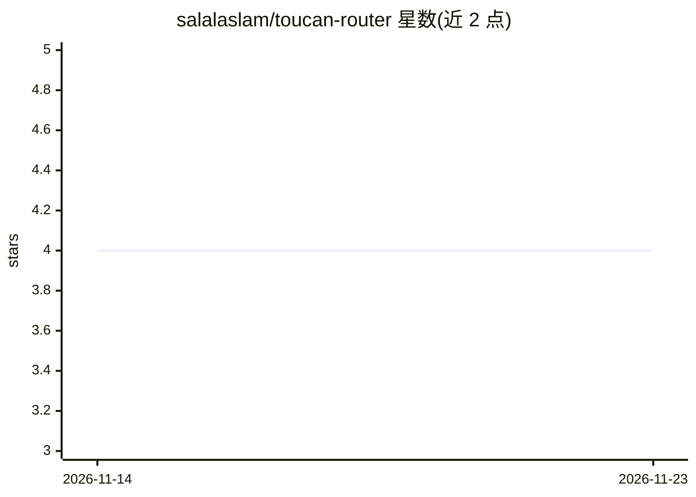

# salalaslam/toucan-router

⭐ 4 · Python · MIT · 推送 2026-11-22 · [GitHub](https://github.com/salalaslam/toucan-router) · 个人维护

**将 WhatsApp/Teams/邮件请求路由到编码代理线程并跟踪回复**

Toucan Router 是一个命令行路由工具，把同事通过 WhatsApp、Microsoft Teams 和邮件发来的请求接入 T3 Code 中已有的 Claude Code 或 Codex 线程：路由按白名单匹配联系人（JID/Entra ID/邮箱），唤醒对应线程处理，并以 claim/reply/promise/done/close/escalate 等命令跟踪每个请求直到回复或升级。回复经 outbox 先写后发，线程上下文过大时移交新线程。仅支持 Linux + systemd，标准库 Python 无依赖。

## 筛选速览

| 维度 | 判定 | 备注 |
|---|---|---|
| AI 角色 | `ai-ecosystem` | LLM/agent 周边工具 |
| 许可风险 | `permissive` | MIT |
| 部署形态 | `library` | 以包/库形式分发 |
| 模型依赖 | — | README 未给出锁定关系 |
| 硬件要求 | — | 无带数字的原话,不猜 |
| 安装摩擦 | `low` | 无编译、无系统依赖或容器化 |
| 成熟度 | — | 结构信号不足 |

## 能力要点

- 把聊天消息路由到已有 T3 线程，自身不运行代理（无 system prompt、无 agent loop）
- claim/reply/promise/done/close/escalate 全生命周期请求跟踪，逾期未兑现发提醒
- 升级卡片机制：生产部署、客户承诺等决策以短卡片发回手机确认
- 回复先写 outbox 再发送，中断标为 uncertain 不会自动重发；线程上下文过大自动移交

## 适用场景

- 让同事通过 WhatsApp 或 Teams 直接给编码代理派活并跟踪进度
- 代理无法自决的事项（部署/客户承诺/费用）一键升级到负责人手机审批
- 在常驻 Linux 服务器上以个人名义运行多项目代理路由

## 场景标签

`编码 Agent` `Agent 框架` `工作流自动化` · 领域:Agent 开发

## 证据(README 行号)

> L11: Toucan Router connects WhatsApp, Microsoft Teams and email to the Claude Code and Codex threads
> L72: Toucan is not an agent harness, a hosted service or a chatbot. It has no system prompt, no model
> L109: Version 0.3. T3 Code is the only supported agent host. Toucan reads some of T3's internal

## 星数曲线

2026-11-14 4 → 2026-11-23 4（+0）

---
*卡片 v1 · prompt 1.4 · 生成 2026-11-21 · 置信度 high · 依据 README sha `45d54a9bac84` · [字段定义](../../DATASET.md)*
