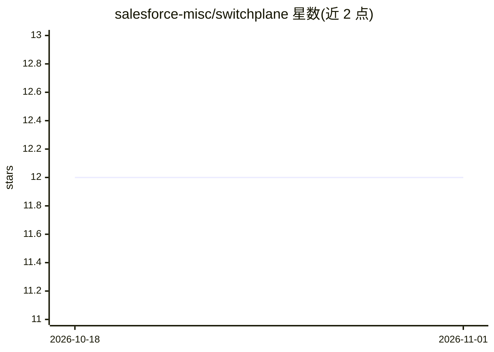

# salesforce-misc/switchplane

⭐ 12 · Python · Apache-2.0 · 推送 2026-08-07 · [GitHub](https://github.com/salesforce-misc/switchplane) · [官网](https://salesforce-misc.github.io/switchplane/) · 组织维护

**把 LangGraph 工作流变成可本地运维的 CLI 应用的运行时**

面向用 LangGraph 编写工作流的应用开发者：以应用定义的图为主干、LLM 调用仅作为需要判断的节点，Switchplane 在图外提供本地控制平面——生成每个应用的 CLI/TUI、任务输入 Pydantic 校验、监督式子进程执行、持久化任务与事件记录、子任务与级联取消、可选的 LangGraph 检查点与显式重试，另有 MCP 服务器注册与带防护的 Shell 执行。要求 Unix-like 系统与 Python 3.12+，pip/uv 安装；自述为 Alpha 软件，API 可能变化；进程隔离非安全沙箱。

## 筛选速览

| 维度 | 判定 | 备注 |
|---|---|---|
| AI 角色 | `ai-ecosystem` | LLM/agent 周边工具 |
| 许可风险 | `permissive` | Apache-2.0 |
| 部署形态 | `library` | 以包/库形式分发 |
| 模型依赖 | — | README 未给出锁定关系 |
| 硬件要求 | — | 无带数字的原话,不猜 |
| 安装摩擦 | `low` | 无编译、无系统依赖或容器化 |
| 成熟度 | `idea` | |

## 能力要点

- 由应用定义的工作流拓扑 + 生成的每应用 CLI/TUI
- 监督式子进程执行、持久化任务/事件记录与子任务级联取消
- 可选 LangGraph 检查点，显式 task retry 恢复
- MCP 服务器注册（stdio/HTTP）与参数数组式受限 Shell

## 适用场景

- 把 LangGraph 编排的 agent 工作流部署为本地可运维的 CLI 应用
- 在可测试、可审计的任务单元中运行含 LLM 节点的工作流
- 任务失败后从检查点显式重试长时运行任务

## 场景标签

`Agent 框架` `工作流自动化` · 领域:Agent 开发

## 证据(README 行号)

> L3: **Switchplane turns LangGraph workflows into locally operable applications, with a generated CLI, supervised task pr
> L7: Most agent harnesses begin with a model-directed loop: give an LLM tools and let it decide what happens next. Switch
> L16: Switchplane is not a coding agent or a replacement for LangGraph. It is the local runtime that turns your workflows

## 星数曲线

2026-10-18 12 → 2026-11-01 12（+0）

---
*卡片 v1 · prompt 1.4 · 生成 2026-11-01 · 置信度 high · 依据 README sha `d22a028a2e6e` · [字段定义](../../DATASET.md)*
