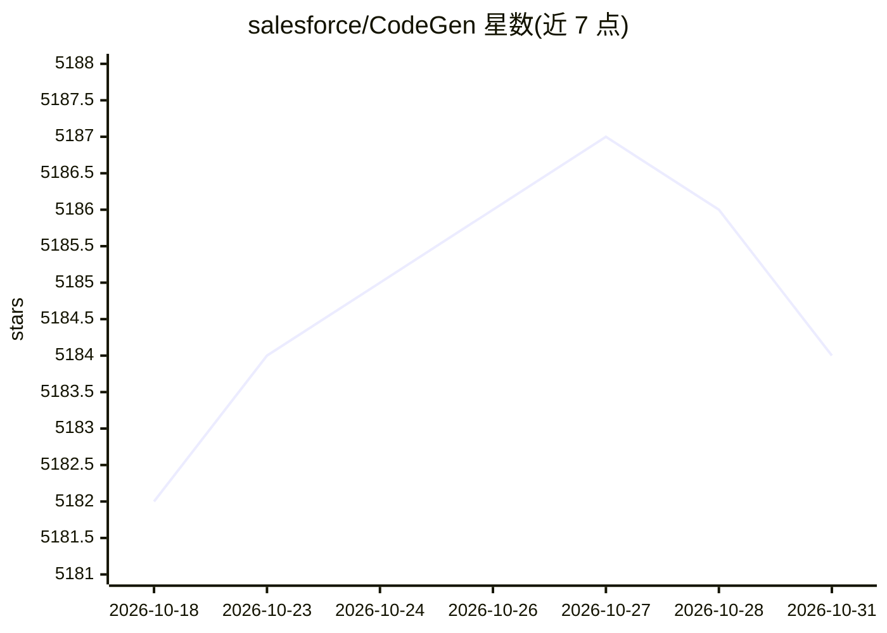

# salesforce/CodeGen

⭐ 5,184 · Python · Apache-2.0 · 推送 2026-06-02 · [GitHub](https://github.com/salesforce/CodeGen) · 组织维护

**Salesforce 开源程序合成代码模型（CodeGen1/2/2.5）**

Salesforce AI Research 发布的程序合成模型系列 CodeGen1、CodeGen2 与 CodeGen2.5，参数规模覆盖 350M 至 16B，在 TPU-v4 上训练。模型托管于 Hugging Face Hub，可通过 transformers 的 AutoTokenizer/AutoModelForCausalLM 加载使用；训练与微调依赖单独的 Jaxformer 库。README 声明本发布仅用于支持学术论文的研究目的，未针对所有下游用途设计或评估，部署前需用户自行评估准确性、安全性与公平性。

## 筛选速览

| 维度 | 判定 | 备注 |
|---|---|---|
| AI 角色 | `ai-native` | 本体是模型或模型工具 |
| 许可风险 | `permissive` | Apache-2.0 |
| 部署形态 | `None` |  |
| 模型依赖 | — | README 未给出锁定关系 |
| 硬件要求 | — | 无带数字的原话,不猜 |
| 安装摩擦 | `low` | 无编译、无系统依赖或容器化 |
| 成熟度 | — | 结构信号不足 |

## 能力要点

- CodeGen1/2/2.5 三个版本，参数规模 350M–16B
- 模型通过 Hugging Face Hub 以 transformers 接口加载
- 训练/微调由独立 Jaxformer 库提供
- 配套两篇 ICLR 2023 论文

## 适用场景

- 研究多轮程序合成与代码补全
- 经 Hugging Face Hub 加载模型做代码生成实验
- 基于 Jaxformer 复现训练或微调流程

## 场景标签

`代码生成` · 领域:编码与开发

## 证据(README 行号)

> L2: Official release for the **CodeGen1** and **CodeGen2** models (`350M`, `1B`, `3B`, `7B` `16B`) for **Program Synthes
> L30: The models are available on the Hugging Face Hub.

## 星数曲线

2026-10-18 5,182 → 2026-10-31 5,184（+2）

---
*卡片 v1 · prompt 1.4 · 生成 2026-10-20 · 置信度 high · 依据 README sha `0bca3a6378c6` · [字段定义](../../DATASET.md)*
