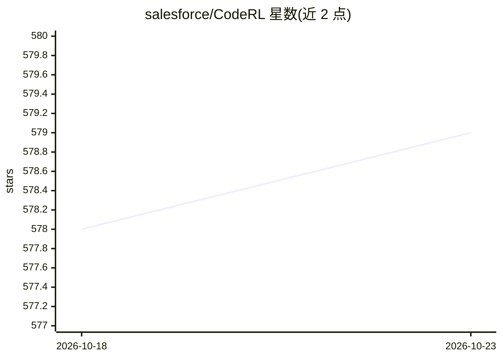

# salesforce/CodeRL

⭐ 579 · Python · BSD-3-Clause · 推送 2026-06-02 · [GitHub](https://github.com/salesforce/CodeRL) · 组织维护

**NeurIPS22 论文官方代码：用强化学习训练代码生成模型**

Salesforce 发布的 CodeRL 论文官方实现：将代码生成语言模型（CodeT5）视为 actor，引入 critic 网络预测生成程序的功能正确性（通过/失败/编译错误/运行时错误四类），训练时提供密集反馈，推理时用 critic 采样策略基于示例单元测试自动重新生成程序。提供预训练与微调模型检查点（Hugging Face 与 Google Cloud Storage）、APPS/MBPP 数据处理流程，以及生成程序、跑单元测试、训练 critic、计算 pass@k 的脚本，支持 DeepSpeed 与 fp16 训练。面向程序合成与强化学习研究人员。

## 筛选速览

| 维度 | 判定 | 备注 |
|---|---|---|
| AI 角色 | `ai-native` | 本体是模型或模型工具 |
| 许可风险 | `permissive` | BSD-3-Clause |
| 部署形态 | `library` | 以包/库形式分发 |
| 模型依赖 | — | README 未给出锁定关系 |
| 硬件要求 | — | 无带数字的原话,不猜 |
| 安装摩擦 | `low` | 无编译、无系统依赖或容器化 |
| 成熟度 | — | 结构信号不足 |

## 能力要点

- actor-critic 框架：critic 预测单元测试结果并给 actor 密集反馈
- 推理阶段 critic 采样：基于示例单元测试与 critic 分数自动重新生成程序
- 发布 CodeT5-large（770M）预训练与 CodeRL 微调检查点
- 提供生成/测试/评估/训练全流程脚本，支持 DeepSpeed 与 fp16

## 适用场景

- 复现论文的强化学习代码生成训练流程
- 在 APPS/MBPP 程序合成基准上训练与评估代码生成模型
- 获取并使用经 RL 微调的 CodeT5 代码生成检查点

## 场景标签

`代码生成` `强化学习` · 领域:编码与开发

## 证据(README 行号)

> L1: ## CodeRL: Mastering Code Generation through Pretrained Models and Deep Reinforcement Learning
> L3: This is the official code for the paper **CodeRL: Mastering Code Generation through Pretrained Models and Deep Reinf
> L34:  A high-level overview of our CodeRL framework for program synthesis (Left) : Our CodeRL framework treats pretraine

## 星数曲线

2026-10-18 578 → 2026-10-23 579（+1）

---
*卡片 v1 · prompt 1.4 · 生成 2026-10-21 · 置信度 mid · 依据 README sha `ae3c510cd83b` · [字段定义](../../DATASET.md)*
