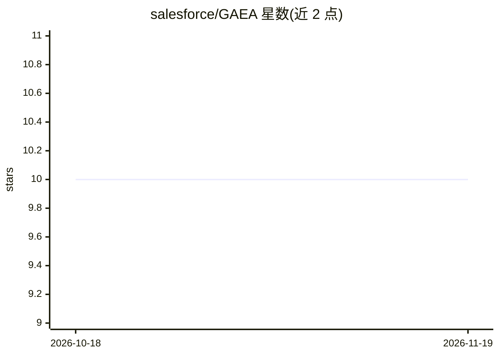

# salesforce/GAEA

⭐ 10 · HTML · BSD-3-Clause · 推送 2026-06-02 · [GitHub](https://github.com/salesforce/GAEA) · 组织维护

**为研究者提供公平设施选址论文的复现代码与数据**

Salesforce Research 论文 GAEA 的配套数据与代码仓库：提供约束图增强与最优设施选址方法，附带芝加哥人口普查/学校/交通合并数据集及 Facebook100 数据获取说明。通过 run_experiments.py 在原始图、基线与所提方法上生成结果，并在输出图上运行蒙特卡洛加权游走模拟，以期望效用与 Gini 指数两项指标评估。代码在 CUDA 11.2 与 tensorflow-gpu 2.6.0 环境下测试，硬件为 32GB 内存 Quadro GV100。

## 筛选速览

| 维度 | 判定 | 备注 |
|---|---|---|
| AI 角色 | `ai-knowledge` | 知识聚合/清单类 |
| 许可风险 | `permissive` | BSD-3-Clause |
| 部署形态 | `library` | 以包/库形式分发 |
| 模型依赖 | — | README 未给出锁定关系 |
| 硬件要求 | — | 无带数字的原话,不猜 |
| 安装摩擦 | `medium` | 含编译或系统依赖之一 |
| 成熟度 | — | 结构信号不足 |

## 能力要点

- 提供论文数据与代码：图增强与设施选址实验
- run_experiments.py 一键生成三类方法的结果
- 评估指标包含期望效用与 Gini 指数
- 附带芝加哥人口/学校/交通合并数据集

## 适用场景

- 复现 GAEA 论文的图增强与选址实验
- 在芝加哥学校网络或 Facebook100 数据上评估公平访问
- 将 Gini 指数类公平指标用于资源分配研究

## 场景标签

`强化学习` · 领域:训练与推理

## 证据(README 行号)

> L3: This repository contains the data and code for Salesforce Research paper: [GAEA: Graph Augmentation for Equitable Ac
> L37: ## Experiments

## 星数曲线

2026-10-18 10 → 2026-11-19 10（+0）

---
*卡片 v1 · prompt 1.4 · 生成 2026-11-19 · 置信度 mid · 依据 README sha `f2a1d67f5642` · [字段定义](../../DATASET.md)*
