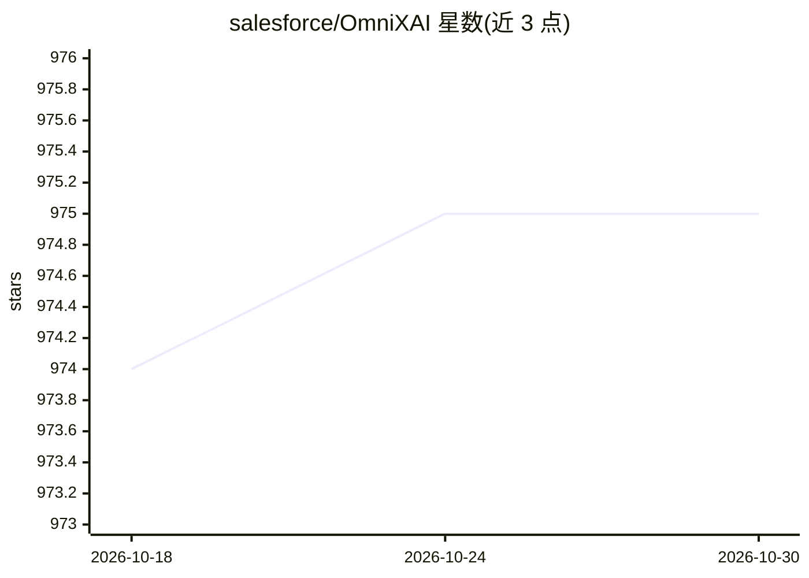

# salesforce/OmniXAI

⭐ 975 · Jupyter Notebook · BSD-3-Clause · 推送 2026-06-02 · [GitHub](https://github.com/salesforce/OmniXAI) · 组织维护

**面向数据科学家的机器学习可解释性（XAI）Python 库**

OmniXAI 是 Salesforce 维护的可解释 AI Python 库，为数据科学家、ML 研究者提供统一接口生成多种解释：支持表格、图像、文本、时间序列四类数据，兼容 Scikit-learn 传统模型与 PyTorch/TensorFlow 深度学习模型，方法涵盖 LIME、SHAP、反事实、Grad-CAM、积分梯度、PDP/ALE 等，并提供 Dash 可视化仪表盘（含 what-if 分析）。限制：GPT 解释器结果不保证 100% 准确（README 自述）。通过 pip 安装，可选 plot/vision/nlp 依赖组。

## 筛选速览

| 维度 | 判定 | 备注 |
|---|---|---|
| AI 角色 | `ai-ecosystem` | LLM/agent 周边工具 |
| 许可风险 | `permissive` | BSD-3-Clause |
| 部署形态 | `library` | 以包/库形式分发 |
| 模型依赖 | — | README 未给出锁定关系 |
| 硬件要求 | — | 无带数字的原话,不猜 |
| 安装摩擦 | `low` | 无编译、无系统依赖或容器化 |
| 成熟度 | — | 结构信号不足 |

## 能力要点

- 统一接口下集成 20+ 种解释方法（LIME/SHAP/MACE/Grad-CAM/PDP 等）
- 支持表格、图像、文本、时间序列四类数据与 Scikit-learn/PyTorch/TensorFlow 模型
- 提供 Dash 可视化仪表盘，支持 what-if 分析与模型对比
- 集成 ChatGPT 生成表格模型的纯文本解释（GPT explainer）

## 适用场景

- 解释表格/图像/文本/时间序列模型的预测决策
- 通过仪表盘做 what-if 分析与模型对比
- 做特征分析、偏差度量与预测性能分析

## 场景标签

 · 领域:机器学习/可解释性

## 证据(README 行号)

> L25: OmniXAI (short for Omni eXplainable AI) is a Python machine-learning library for explainable AI (XAI), offering omn
> L32: OmniXAI includes a rich family of explanation methods integrated in a unified interface, which
> L33: supports multiple data types (tabular data, images, texts, time-series), multiple types of ML models
> L34: (traditional ML in Scikit-learn and deep learning models in PyTorch/TensorFlow), and a range of diverse explainatio

## 星数曲线

2026-10-18 974 → 2026-10-30 975（+1）

---
*卡片 v1 · prompt 1.4 · 生成 2026-10-21 · 置信度 high · 依据 README sha `6bfe0ae2b704` · [字段定义](../../DATASET.md)*
