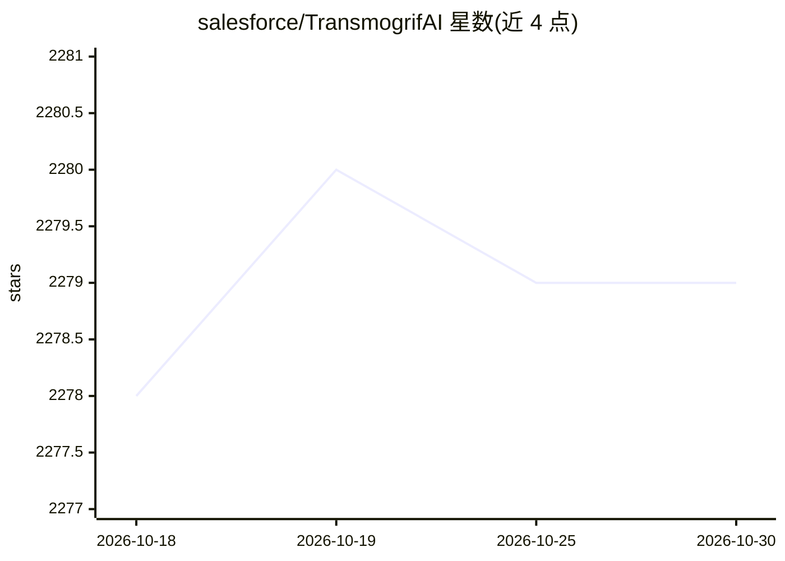

# salesforce/TransmogrifAI

⭐ 2,279 · Scala · BSD-3-Clause · 推送 2026-06-02 · [GitHub](https://github.com/salesforce/TransmogrifAI) · [官网](https://transmogrif.ai) · 组织维护

**Apache Spark 上的 Scala AutoML 库，自动构建机器学习工作流**

Salesforce 开源的 AutoML 库，用 Scala 编写，运行于 Apache Spark 之上。通过自动化特征工程、模型选择与评估，在少量手工调参下构建模块化、可复用、强类型的机器学习工作流；API 在编译期强制类型安全。用户也可以完全手动指定特征与算法以获得控制权。以 Maven/Gradle/SBT 依赖形式集成到现有项目，版本矩阵要求 Spark 2.2-2.4、Scala 2.11、Java 1.8。README 展示了泰坦尼克生存预测的完整示例。

## 筛选速览

| 维度 | 判定 | 备注 |
|---|---|---|
| AI 角色 | `ai-native` | 本体是模型或模型工具 |
| 许可风险 | `permissive` | BSD-3-Clause |
| 部署形态 | `None` |  |
| 模型依赖 | — | README 未给出锁定关系 |
| 硬件要求 | — | 无带数字的原话,不猜 |
| 安装摩擦 | `low` | 无编译、无系统依赖或容器化 |
| 成熟度 | — | 结构信号不足 |

## 能力要点

- 自动化特征工程、模型选择与评估（自动评估 Logistic Regression / Random Forest）
- 编译期类型安全的强类型 DSL，支持完全手动指定特征与算法
- 以 Maven Central 依赖形式提供（Gradle/SBT 集成）

## 适用场景

- 在 Spark 上快速构建生产级结构化数据机器学习应用
- 减少手工调参的自动建模
- 构建模块化、可复用的强类型 ML 流水线

## 场景标签

`MLOps` · 领域:训练与推理

## 证据(README 行号)

> L7: TransmogrifAI (pronounced trăns-mŏgˈrə-fī) is an AutoML library written in Scala that runs on top of Apache Spark. I
> L25: The Titanic dataset is an often-cited dataset in the machine learning community. The goal is to build a machine lea

## 星数曲线

2026-10-18 2,278 → 2026-10-30 2,279（+1）

---
*卡片 v1 · prompt 1.4 · 生成 2026-10-21 · 置信度 high · 依据 README sha `e69e18a652e4` · [字段定义](../../DATASET.md)*
