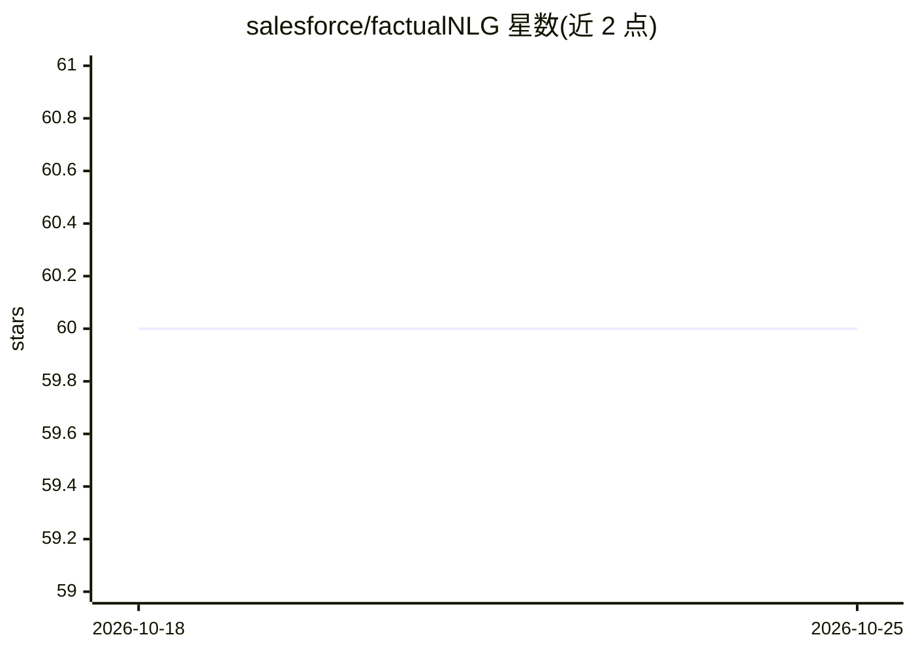

# salesforce/factualNLG

⭐ 60 · Jupyter Notebook · Apache-2.0 · 推送 2026-06-02 · [GitHub](https://github.com/salesforce/factualNLG) · [官网](https://arxiv.org/abs/2305.14540) · 组织维护

**论文代码库：摘要事实一致性基准 SummEdits 的数据与提示词发布**

arXiv 论文《LLMs as Factual Reasoners》的官方代码仓库，发布 SummEdits 基准：覆盖 10 个领域的摘要编辑一致性判定任务，附模型评测结果表格（含 Llama2、GPT-4、Gemini-pro 等）、数据集访问 notebook、3.6k 条 FactCC 模型解释的人工标注，以及实验所用全部提示词文件。供 NLP 研究者复现实验或使用基准数据。

## 筛选速览

| 维度 | 判定 | 备注 |
|---|---|---|
| AI 角色 | `ai-knowledge` | 知识聚合/清单类 |
| 许可风险 | `permissive` | Apache-2.0 |
| 部署形态 | `None` |  |
| 模型依赖 | — | README 未给出锁定关系 |
| 硬件要求 | — | 无带数字的原话,不猜 |
| 安装摩擦 | `low` | 无编译、无系统依赖或容器化 |
| 成熟度 | — | 结构信号不足 |

## 能力要点

- 发布 10 个领域的 SummEdits 基准数据（data/summedits）
- 提供基准访问与可视化的 Jupyter notebook
- 3.6k 条 FactCC 不一致解释的人工标注
- 公开实验所用的全部提示词（零样本/少样本/编辑生成）

## 适用场景

- 复现论文中的 LLM 事实一致性评测
- 使用 SummEdits 数据评测摘要事实一致性模型
- 分析模型判定不一致摘要时的解释质量

## 场景标签

`模型评测` `提示工程` · 领域:Agent 开发

## 证据(README 行号)

> L1: # Factual Consistency in Summarization
> L32: ## SummEdits Benchmark Release (Section 6-7)
> L34: We release the data for the 10 domains in the SummEdits benchmark in the data/summedits folder.

## 星数曲线

2026-10-18 60 → 2026-10-25 60（+0）

---
*卡片 v1 · prompt 1.4 · 生成 2026-10-24 · 置信度 high · 依据 README sha `8a44c5a21fc3` · [字段定义](../../DATASET.md)*
