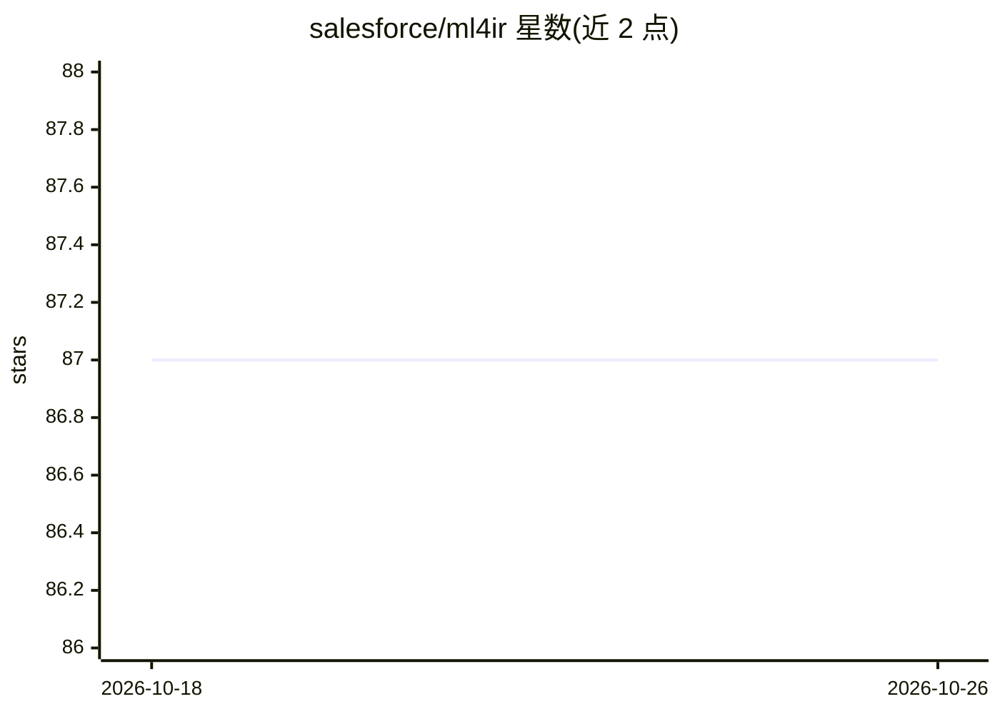

# salesforce/ml4ir

⭐ 87 · Jupyter Notebook · Apache-2.0 · 推送 2026-06-02 · [GitHub](https://github.com/salesforce/ml4ir) · 组织维护

**面向搜索应用的深度学习模型训练与部署库**

基于 Python3 与 TensorFlow 2.x 的开源库，提供搜索类深度学习模型的端到端训练与评估，并附带 Scala 工具用于 JVM 推理。以模块化子组件构建学习排序、查询自动补全、文档/查询分类、命名实体识别、Query2SQL 等任务模型；支持通过配置文件控制各组件，训练与推理共用同一配置，可接入特征存储或 Solr 部署。使用 TFRecord 数据管道，附带 CSV/libsvm 转换工具。

## 筛选速览

| 维度 | 判定 | 备注 |
|---|---|---|
| AI 角色 | `ai-ecosystem` | LLM/agent 周边工具 |
| 许可风险 | `permissive` | Apache-2.0 |
| 部署形态 | `library` | 以包/库形式分发 |
| 模型依赖 | — | README 未给出锁定关系 |
| 硬件要求 | — | 无带数字的原话,不猜 |
| 安装摩擦 | `low` | 无编译、无系统依赖或容器化 |
| 成熟度 | — | 结构信号不足 |

## 能力要点

- 模块化子组件可覆盖、混搭以构建搜索 ML 模型
- 子组件可完全通过配置文件控制，训练与推理共用配置
- TFRecord 数据管道，支持 CSV/libsvm 格式转换
- 附带 Scala 工具用于 JVM 推理

## 适用场景

- 训练学习排序模型用于搜索排序
- 构建查询自动补全、查询分类等搜索 ML 应用
- 将训练好的模型接入 Solr 或特征存储部署到生产环境

## 场景标签

`模型训练` · 领域:训练与推理

## 证据(README 行号)

> L7: ml4ir is an open source library for training and deploying deep learning models for search applications. ml4ir is bu
> L9: ml4ir is designed as modular subcomponents which can each be combined and customized to build a variety of search ML

## 星数曲线

2026-10-18 87 → 2026-10-26 87（+0）

---
*卡片 v1 · prompt 1.4 · 生成 2026-10-23 · 置信度 mid · 依据 README sha `eba640b52410` · [字段定义](../../DATASET.md)*
