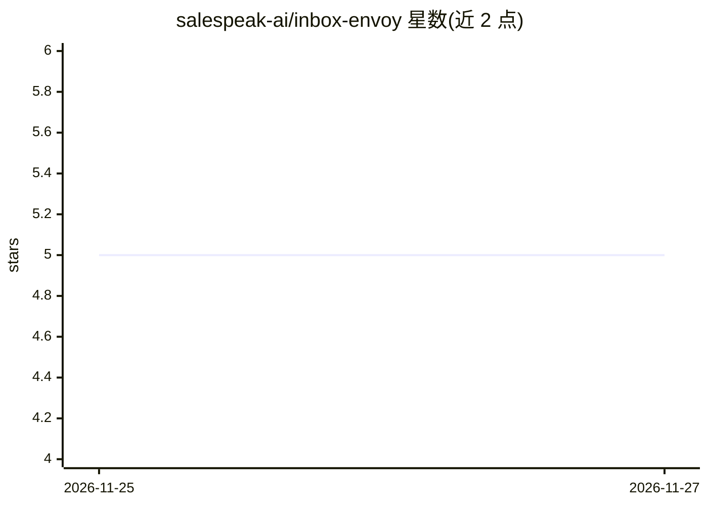

# salespeak-ai/inbox-envoy

⭐ 5 · Python · MIT · 推送 2026-11-22 · [GitHub](https://github.com/salespeak-ai/inbox-envoy) · 组织维护

**教会个人 AI 代理分拣邮件并调研陌生邀约的开放技能包**

一个以 SKILL.md 为核心的技能包（MIT 许可，公开 beta），部署到已有的个人 AI 代理上，用于对收件箱邮件进行分类、打标、归档建议，并可在单独授权下调研陌生商业邀约——优先检索公开公司文档或已发布的公司代理协议（PAP/A2A/MCP）。它不是邮件服务或邮箱连接器，要求宿主代理已具备邮件工具与调度能力；默认 Observe 只读模式，标签、归档、外发均需逐级单独授权，无永久删除。提供 ZIP、skills CLI 与 Claude Code 插件市场三种安装途径，附测试收件箱与参考答案。

## 筛选速览

| 维度 | 判定 | 备注 |
|---|---|---|
| AI 角色 | `ai-native` | 本体是模型或模型工具 |
| 许可风险 | `permissive` | MIT |
| 部署形态 | `desktop` | 安装包/桌面程序 |
| 模型依赖 | locked-api |  |
| 硬件要求 | — | 无带数字的原话,不猜 |
| 安装摩擦 | `low` | 无编译、无系统依赖或容器化 |
| 成熟度 | `idea` | |

## 能力要点

- 基于 SKILL.md 的可移植技能包，依赖宿主代理已有的邮件与调度能力
- 三级渐进授权模式：Observe（只读）→ Label-only → Archive，均可回滚
- 陌生邀约调研优先使用公开公司文档与 PAP/A2A/MCP 公司代理协议
- 自带九封虚构邮件的测试收件箱与答案键，可脱离真实邮箱试用

## 适用场景

- 让个人 AI 代理代为整理收件箱并高亮重要与机会类邮件
- 在接听陌生销售邀约前先做公开资料调研
- 以只读方式先试用邮件分类，确认准确后再逐步授权归档

## 场景标签

 · 领域:个人效率/AI 代理技能

## 证据(README 行号)

> L13: An open, portable skill that teaches an existing personal agent to protect your inbox, organize mail, highlight opp
> L15: This is **a skill, not an email provider, separate inbox, continuous-monitoring service, or new mailbox connector**
> L19: Inbox Envoy is designed for intelligent personal agents that can load a skill (a folder with `SKILL.md` plus refere

## 星数曲线

2026-11-25 5 → 2026-11-27 5（+0）

---
*卡片 v1 · prompt 1.4 · 生成 2026-11-25 · 置信度 high · 依据 README sha `ba68f1fbf627` · [字段定义](../../DATASET.md)*
