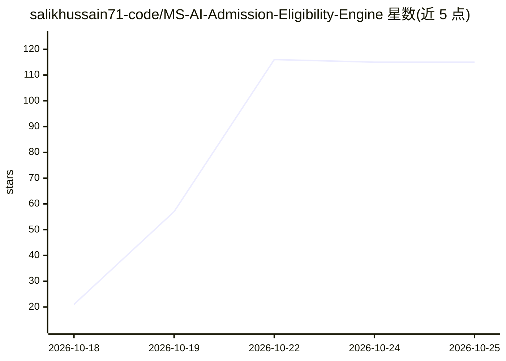

# salikhussain71-code/MS-AI-Admission-Eligibility-Engine

⭐ 115 · Python · MIT · 推送 2026-10-05 · [GitHub](https://github.com/salikhussain71-code/MS-AI-Admission-Eligibility-Engine) · 个人维护

**面向 AI/CS 硕士项目的入学资格规则校验引擎**

Python 编写的资格评估引擎：将 MBZUAI、KAUST、LUMS 等院校硕士项目官方公布的入学要求转译为结构化规则，读取申请者的本科 CGPA、英语成绩、GRE、先修课等输入，输出是否符合已收录资格标准的判定，规则可溯源至官方文档。系统明确声明不做录取预测，仅回答“是否满足已收录的公布标准”，且资格达标不保证录取、奖学金等结果；院校要求可能随申请周期变化，用户需自行核对最新官方要求。

## 筛选速览

| 维度 | 判定 | 备注 |
|---|---|---|
| AI 角色 | `ai-enhanced` | 去掉 AI 部分产品仍成立 |
| 许可风险 | `permissive` | MIT |
| 部署形态 | `None` |  |
| 模型依赖 | — | README 未给出锁定关系 |
| 硬件要求 | — | 无带数字的原话,不猜 |
| 安装摩擦 | `low` | 无编译、无系统依赖或容器化 |
| 成熟度 | — | 结构信号不足 |

## 能力要点

- 将官方入学要求转译为结构化规则并校验申请者输入
- 覆盖 MBZUAI、KAUST、LUMS 的部分硕士项目
- 规则可溯源至院校官方招生文档
- 明确限定为资格判定而非录取预测

## 适用场景

- 申请前自查是否满足目标项目的已公布最低要求
- 核对 CGPA/英语/GRE 等硬性门槛是否达标

## 场景标签

 · 领域:教育/研究生申请

## 证据(README 行号)

> L3: A source-grounded Python eligibility engine for evaluating applicant profiles against published admission requiremen
> L13: The goal is not to predict admission.

## 星数曲线

2026-10-18 21 → 2026-10-25 115（+94）

---
*卡片 v1 · prompt 1.4 · 生成 2026-10-23 · 置信度 low · 依据 README sha `f219be4201c3` · [字段定义](../../DATASET.md)*
